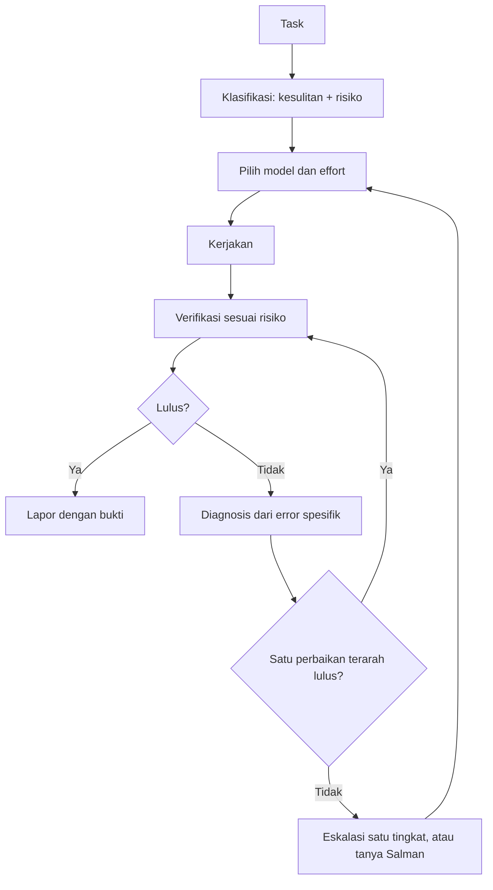

# MODEL-POLICY — Router model, effort, dan verifikasi

> Dibaca AI bersama `WORKFLOW.md`. Polanya: **klasifikasi → pilih model + effort → kerjakan → verifikasi menurut risiko → bila gagal, diagnosis lalu eskalasi**.
> Pola ini mengikuti referensi "AI Levels" (level GOAT). Angka penghematan di video itu hasil simulasi, bukan janji; di project ini hasilnya **diukur sendiri** (§10).
> Hanya Salman yang mengubah file ini.

## 1. Batasan platform (jujur soal apa yang otomatis)

Claude Code tidak punya router yang memindahkan model sesi utama sendiri, dan AI tidak bisa mengganti modelnya sendiri. Router di sini dibangun dari bagian yang memang ada:

| Mekanisme | Sifat | Fungsi |
| --------- | ----- | ------ |
| Klasifikasi di langkah "Rencana singkat" (WORKFLOW §2) | Otomatis (AI wajib menulisnya) | Menentukan tingkat kesulitan dan risiko |
| Subagent `tier-easy`, `tier-medium`, `tier-hard` (`.claude/agents/`) | Otomatis (dipilih dari deskripsi atau dari prompt delegasi) | Menjalankan bagian pekerjaan di model + effort yang pas |
| `model` dan `effort` di frontmatter skill | Otomatis saat skill dipanggil | `/review-security` → Opus high, `/test-feature` → Sonnet medium, dst. |
| Default project `"model": "sonnet"` | Otomatis | Titik awal murah |
| `/model` dan `/effort` untuk sesi utama | **Manual oleh Salman** | Task yang sejak awal Hard |

**Ketersediaan model tidak boleh diasumsikan.** Daftar model yang benar-benar bisa dipakai dilihat lewat `/model`. Bila model yang dibutuhkan tidak tersedia, pakai yang terbaik yang ada dan **laporkan keterbatasannya**. Jangan mengklaim sudah memakai model yang tidak tersedia. Jangan mengaktifkan extra usage, billing API, atau kredit berbayar tanpa persetujuan Salman.

## 2. Alur



## 3. Dua sumbu yang dipisahkan

Kesulitan dan risiko **tidak sama**. Mengubah satu baris izin akses itu mudah secara teknis tapi risikonya kritis.

| Sumbu | Ditentukan oleh | Menentukan |
| ----- | --------------- | ---------- |
| **Kesulitan**: kompleksitas, ketidakpastian, cakupan | Rubrik §4 | Model dan effort |
| **Risiko**: dampak bila hasil salah | Rubrik §5 | Kedalaman verifikasi, effort minimum, dan perlu-tidaknya review independen |

### Router

| Kesulitan | Model | Effort |
| --------- | ----- | ------ |
| **Easy** | `haiku` | `low` |
| **Medium** | `sonnet` | `medium` |
| **Hard** | `opus` | `high` |

Penyesuaian karena risiko:
- **R3**: model minimal Medium.
- **R4**: model minimal Medium dengan effort `high`; bila kesulitannya Hard, effort naik ke `xhigh`. Wajib review independen (§6).
- `fable` (via `/model fable`) hanya atas keputusan Salman setelah tingkat Hard `xhigh` gagal dua kali, dan hanya bila tersedia di akun. Review keamanan tetap di Opus.

Contoh: "ubah izin role di satu baris" → kesulitan Easy, risiko R4 → Sonnet `high` + verifikasi R4 + review independen. "Seeder demo" → Easy, R1 → Haiku `low` + cek format.

## 4. Rubrik kesulitan

Mulai dari Easy; naik satu tingkat per sinyal; ambil yang tertinggi.

- **Easy**: jawabannya terbaca dari repo, mekanis (cari, rangkum, rename, format, update catatan, salin pola seeder).
- **Naik ke Medium**: logika baru yang mengikuti pola yang ada, lebih dari 1 file, perlu test baru, ada query/validasi/UI baru.
- **Naik ke Hard**: ada salah satu dari: concurrency/locking/antrian/idempotency; transaksi multi-tabel; desain atau ADR; requirement ambigu atau bertentangan; lintas modul atau > 10 file; bug yang tidak terreproduksi atau sudah gagal sekali; performa (query plan, indeks, materialized view, uji beban); migrasi atau cutover.
- **Turun satu tingkat**: pekerjaan hanya menyalin pola yang sudah ada.

## 5. Rubrik risiko dan verifikasi

| Risiko | Contoh | Verifikasi wajib (deterministik dulu) |
| ------ | ------ | -------------------------------------- |
| **R1 Rendah** | Dokumen, catatan, seeder demo, teks UI | `pint --test`, build lolos, baca diff |
| **R2 Sedang** | Layar, laporan, import, CRUD tanpa aturan uang/stok | R1 + test fitur untuk perilaku yang diubah + `phpstan` |
| **R3 Tinggi** | Kuantitas/uang, dokumen stok, state machine, skema data, ADR | R2 + seluruh suite (regresi) + kasus tepi + izin diuji dua arah + `inventory:verify` bila menyentuh stok + audit log + `down()` migration teruji |
| **R4 Kritis** | Auth, RBAC, scope lokasi, ledger, token API, migrasi/cutover, produksi | R3 + `/review-security` (Opus, independen) + rencana rollback tertulis + persetujuan Salman untuk tindakan destruktif atau di luar lokal; status maksimum `review` |

Aturan verifikasi:
- Utamakan alat yang bisa dijalankan (test runner, Pint, Larastan, `inventory:verify`, build). Review LLM adalah **tambahan** di R4, bukan pengganti.
- Verifikasi dijalankan **oleh pelaksana pekerjaan** dan hasilnya ditempel di laporan. Klaim tanpa output perintah dianggap belum diverifikasi.
- Tidak menjalankan verifikasi lebih berat dari tingkat risikonya (suite penuh berulang untuk R1 adalah pemborosan kuota).

## 6. Gagal → diagnosis → eskalasi

1. Verifikasi gagal → ambil **error spesifik** (jangan menebak); diagnosis penyebabnya.
2. **Satu** perbaikan terarah, lalu verifikasi ulang.
3. Masih gagal → naikkan **satu tingkat**: Haiku low → Sonnet medium → Opus high → Opus xhigh. Lanjutkan di tingkat baru dengan error terakhir sebagai konteks.
4. Batas: maksimal **2 percobaan per tingkat**, maksimal **2 eskalasi**, maksimal **6 percobaan total** per task. Setelah itu berhenti dan tanya Salman (WORKFLOW §4). Jangan mengulang tanpa perubahan pendekatan.
5. Sebelum menaikkan model untuk pekerjaan yang gagal karena spesifikasi kurang jelas: itu masalah ketidakpastian, bukan kekuatan model. Tanya, jangan eskalasi.
6. Aturan "eskalasi" tidak berlaku untuk R4: tindakan destruktif atau di luar lokal tetap butuh persetujuan Salman di semua tingkat.

## 7. Delegasi dan kuota

- Delegasikan ke subagent hanya bila **manfaatnya melebihi biayanya**: bagian pekerjaannya cukup besar (kira-kira lebih dari 10 menit kerja atau banyak file) **atau** tingkatnya jelas berbeda dari sesi. Pekerjaan kecil dikerjakan langsung di sesi.
- Subagent mulai tanpa konteks percakapan. Prompt delegasi wajib memuat: ID task, file relevan, kriteria selesai, tingkat kesulitan dan risiko, larangan scope. Hasilnya diverifikasi ulang di sesi utama.
- Subagent ikut memakai kuota. Satu task, maksimal satu subagent per tingkat pada satu waktu.
- Bila sesi sudah di tingkat yang pas untuk task, tidak perlu mendelegasikan apa pun.
- AI tidak boleh mengarang angka token, biaya, atau hasil test. Bila tidak tahu, katakan tidak tahu.

## 8. Pekerjaan di luar task

| Pekerjaan | Kesulitan | Risiko | Cara |
| --------- | --------- | ------ | ---- |
| Mencari file, merangkum diff, menjelaskan kode | Easy | R1 | `tier-easy` atau langsung |
| Update `TODO.md`, catatan, handoff | Easy | R1 | Langsung di sesi |
| Seeder/factory dengan pola yang ada | Easy | R1 | `tier-easy` |
| Menulis test untuk kode yang ada | Medium | R2 | `/test-feature` |
| CRUD dan layar Livewire standar | Medium | R2 | `/laravel-domain-feature` |
| Refactor dalam satu modul | Medium | R2–R3 | `/refactor-safely` |
| Debug dengan penyebab jelas | Medium | sesuai area | Langsung |
| Debug tidak jelas, race condition | Hard | R3–R4 | `tier-hard` atau `/model opus` |
| Review keamanan | Hard | R4 | `/review-security` |
| ADR, ERD, keputusan arsitektur | Hard | R3 | `/model opus` |
| Ledger, posting stok, rekonsiliasi | Hard | R4 | `/model opus` + `/effort xhigh` |

## 9. Peta task Fase 1

**Kesulitan**
- **Easy (7):** T0.01, T0.03, T1.13, T1.14, T3.11, T5.08, T6.07
- **Hard (22):** T0.02, T0.06, T1.02, T1.04, T2.01, T2.02, T2.03, T2.04, T2.09, T3.05, T3.06, T3.10, T4.02, T4.03, T4.05, T4.08, T5.01, T5.09, T6.01, T6.02, T6.04, T6.05
- **Medium (44):** semua task lainnya

**Risiko**
- **R4 (14):** T1.02, T1.03, T1.04, T1.05, T1.08, T2.02, T2.03, T2.09, T3.02, T3.07, T4.08, T6.02, T6.04, T6.05
- **R3 (23):** T0.02, T0.06, T0.09, T1.01, T1.07, T2.01, T2.04, T2.05, T2.06, T2.07, T2.08, T2.10, T2.11, T3.05, T3.06, T3.09, T4.02, T4.03, T4.04, T4.05, T4.06, T4.07, T5.01
- **R1 (8):** T0.01, T0.03, T0.07, T0.08, T1.14, T3.11, T6.06, T6.07
- **R2 (28):** semua task lainnya

**Hasil gabungan yang perlu diingat**
- **Opus `xhigh` (Hard + R4, 9):** T1.02, T1.04, T2.02, T2.03, T2.09, T4.08, T6.02, T6.04, T6.05
- **Sonnet `high` karena R4 (5):** T1.03, T1.05, T1.08, T3.02, T3.07
- **Opus `high` (Hard, bukan R4, 13):** sisanya dari daftar Hard

Task Fase 2–7 dinilai dengan rubrik §4 dan §5 saat sesi perencanaan fasenya. Penilaian yang meleset dicatat sebagai isu `debt` agar peta ini diperbaiki.

## 10. Pengukuran

Setiap task yang selesai dicatat satu baris di **Log model** pada `TODO.md` (§12): tingkat awal, tingkat akhir, jumlah percobaan, lulus verifikasi, perlu intervensi manusia, catatan kuota. `php scripts/todo-summary.php` menghitung ringkasannya:

| Metrik | Rumus |
| ------ | ----- |
| Verified success rate | task lulus verifikasi / task tercatat |
| Escalation rate | task dengan tingkat akhir ≠ tingkat awal / task tercatat |
| Rata-rata percobaan | total percobaan / task tercatat |
| Human intervention rate | task yang butuh bantuan manusia / task tercatat |

Cara membacanya: bila escalation rate tinggi pada task Medium, rubrik terlalu rendah menilai; bila hampir nol pada task Hard dan semua lulus, mungkin terlalu tinggi. Hitung juga kuota nyata dari `/usage` sebelum dan sesudah satu milestone. Strategi termurah **bukan** pemenang bila verified success rate-nya lebih rendah.

## 11. Kartu cepat untuk Salman

```text
/model                # lihat model yang benar-benar tersedia di akun
/model sonnet         # default project
/model opus           # task Hard
/effort high          # Hard, atau R4 pada task Medium
/effort xhigh         # Hard + R4 (ledger, izin, migrasi)
/effort auto          # kembali ke bawaan model
/model opusplan       # Opus saat plan mode, Sonnet saat eksekusi
```

Format saran AI bila sesi tidak cocok (satu baris di awal respons):
`T2.02 · Kesulitan Hard · R4 → butuh Opus xhigh. Sesi sekarang Sonnet medium. Saran: /model opus lalu /effort xhigh. Lanjut di sini atau ganti dulu?`

## 12. Kebijakan ringkas (versi satu paragraf untuk AI)

Klasifikasikan setiap task menurut kesulitan dan risiko, dan tulis hasilnya di rencana. Pilih jalur termurah yang didukung dan cukup andal untuk kesulitannya; risiko menentukan kedalaman verifikasi dan effort minimum. Delegasikan hanya bila manfaatnya melebihi overhead. Verifikasi dengan alat deterministik dan tempel hasilnya. Bila gagal, diagnosis dari error spesifik, perbaiki satu kali secara terarah, baru eskalasi satu tingkat; berhenti dan tanya setelah batas percobaan. Tindakan destruktif dan penggunaan berbayar tak terduga butuh persetujuan Salman. Jangan pernah mengarang ketersediaan model, jumlah token, biaya, atau hasil test.
