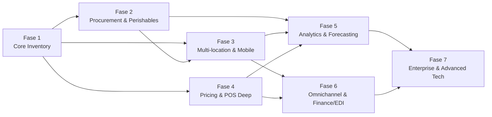
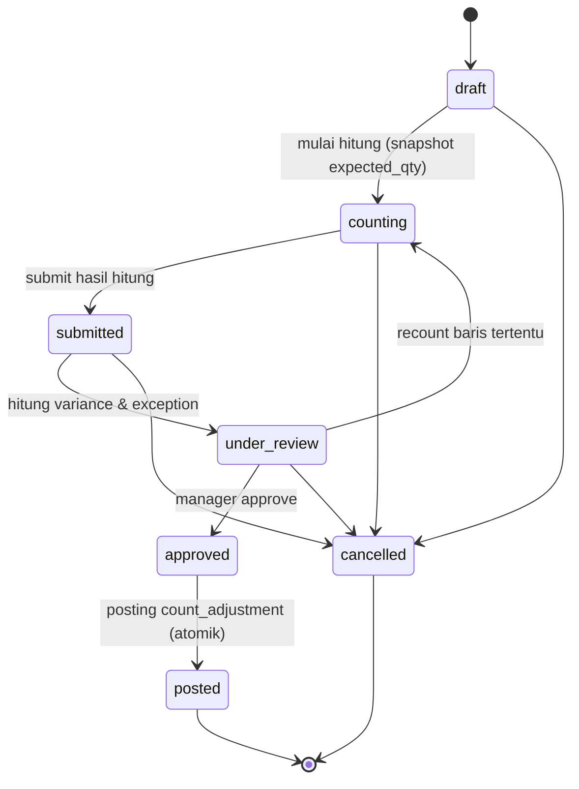

# Product Requirements Document (PRD) — Retail Inventory Management Platform

| Item            | Detail                                                                                                         |
| --------------- | -------------------------------------------------------------------------------------------------------------- |
| Dokumen sumber  | `project-brief-retail-inventory.md` (Fase 1), `roadmap-fase-full-retail-inventory.md` (Fase 1–7)               |
| Tech stack inti | Laravel · Livewire · Bootstrap · PostgreSQL (+ Python/FastAPI untuk forecasting di Fase 5)                     |
| Cakupan dokumen | Seluruh project, 7 fase; Fase 1 dirinci sampai user story & acceptance criteria                                |
| Versi           | 0.2 — 5 November 2026                                                                                          |
| Status          | Draft — menunggu validasi target NFR oleh systems architect klien dan jawaban pertanyaan validasi (§6.1.11, §9) |

### Riwayat perubahan

| Versi | Tanggal         | Perubahan                                                                                                                                                                                                                                                                   |
| ----- | --------------- | --------------------------------------------------------------------------------------------------------------------------------------------------------------------------------------------------------------------------------------------------------------------------- |
| 0.1   | 5 November 2026 | Draft awal dari roadmap 7 fase                                                                                                                                                                                                                                              |
| 0.2   | 5 November 2026 | Tambah: batasan kontrak & pemetaan deliverable klien (§2), peran & hak akses (§4), detail Fase 1 dari project brief + user story & acceptance criteria (§6.1), NFR terukur (§7), migrasi data & go-live (§8). Stack UI ditetapkan Bootstrap + Livewire. Open item #1 ditutup |

---

## 1. Latar Belakang & Tujuan

### 1.1 Problem statement

Convenience store dan retailer kecil-menengah umumnya mengelola stok secara manual atau dengan tool yang tidak terintegrasi (spreadsheet, POS berdiri sendiri, catatan fisik). Ini menyebabkan:

- Selisih stok yang tidak terdeteksi hingga stock count manual.
- Barang kedaluwarsa tidak terpantau sampai jadi kerugian (write-off).
- Pembelian reaktif (kehabisan stok) atau over-ordering (modal tertahan di stok mati).
- Tidak ada visibilitas lintas toko saat jaringan bertambah.
- Kebocoran margin dari shrinkage yang tidak teranalisis sumbernya.

### 1.2 Tujuan produk

Membangun platform manajemen inventaris retail yang tumbuh bersama bisnis klien — dari satu toko ke jaringan multi-lokasi, dari POS manual ke integrasi real-time, dari pencatatan ke keputusan berbasis data (forecasting, loss prevention) — dengan ledger stok immutable sebagai sumber kebenaran di setiap tahap.

### 1.3 Target pengguna

- **Staff toko**: input penerimaan, stock count, scanning mobile.
- **Store manager**: approval, rekonsiliasi, dashboard performa toko.
- **Purchasing/procurement**: PO, supplier, reorder.
- **Finance/akunting**: valuasi persediaan, jurnal, tutup buku.
- **Business owner / regional manager**: KPI lintas toko, keputusan strategis (markdown, ekspansi, franchise).
- **Systems architect klien**: sign-off arsitektur & governance tiap milestone.

Pemetaan pengguna ke peran sistem dan hak aksesnya ada di §4.

### 1.4 Konteks bisnis yang membentuk prioritas

- Klien: convenience store dengan rencana ekspansi multi-lokasi.
- Kategori produk dominan kemungkinan punya tanggal kedaluwarsa → batch/expiry control adalah kebutuhan inti, bukan opsional.
- Hubungan dengan klien bersifat jangka panjang (partner), bukan proyek sekali jalan → arsitektur harus modular dan siap diperluas per fase.

---

## 2. Batasan Kontrak & Deliverable Klien

Bagian ini berasal langsung dari requirement klien dan berlaku untuk seluruh fase. Requirement di bagian lain tidak boleh bertentangan dengan bagian ini.

### 2.1 Kerahasiaan, kepemilikan & infrastruktur

| ID   | Requirement                                                                                                                                                                 |
| ---- | --------------------------------------------------------------------------------------------------------------------------------------------------------------------------- |
| C-01 | Perjanjian kerahasiaan (NDA) dan perjanjian kekayaan intelektual ditandatangani sebelum developer menerima detail sensitif project.                                         |
| C-02 | Seluruh source code, database, dokumentasi teknis, dan deliverable terkait menjadi milik klien melalui ketentuan kepemilikan dan pengalihan (assignment) di kontrak.        |
| C-03 | Repository dan infrastruktur project (cloud, database, domain, CI/CD, secret) berada di akun yang dikendalikan klien. Developer bekerja sebagai kolaborator dengan akses yang bisa dicabut. |
| C-04 | Kredensial dan secret disimpan di secret manager / environment milik klien, tidak pernah di-commit ke repository.                                                          |
| C-05 | Demonstrasi awal wajib memakai **sample data**. Tidak ada koneksi ke toko live atau POS live tanpa **otorisasi tertulis terpisah** dari klien.                              |
| C-06 | Seorang **independent systems architect** dari pihak klien menetapkan requirement teknis, mereview arsitektur, dan mengawasi kualitas. Setiap milestone ditutup dengan demo dan sign-off architect. |

### 2.2 Pemetaan deliverable awal klien

| #   | Deliverable yang diminta klien                       | Dipenuhi oleh                                                       | Milestone Fase 1 |
| --- | ---------------------------------------------------- | ------------------------------------------------------------------- | ---------------- |
| 1   | Proposed software development architecture           | Dokumen arsitektur, ERD, ADR (§6.1.2–6.1.5)                         | M0               |
| 2   | Detailed development plan & milestone schedule       | Rencana milestone (§6.1.8)                                          | M0               |
| 3   | Functional inventory database prototype              | Skema PostgreSQL + seeder sample data                               | M1               |
| 4   | Demonstration of SKU tracking & inventory reconciliation | Demo ledger (E2) dan stock count & rekonsiliasi (E4) dengan sample data | M2 + M4          |
| 5   | Preliminary management dashboard                     | Dashboard & laporan (E5)                                            | M5               |
| 6   | Technical documentation & source-code handover       | Dokumentasi teknis, API docs, user guide, serah terima repo         | M6               |
| 7   | Development budget & implementation timeline         | Dokumen proposal terpisah, berbasis estimasi jam di §5 dan §6.1.8   | M0 (proposal)    |

---

## 3. Prinsip Desain Lintas Fase

Berlaku di semua fase, tidak berubah seiring penambahan fitur:

| Area        | Prinsip                                                                                                                                           |
| ----------- | ------------------------------------------------------------------------------------------------------------------------------------------------- |
| Arsitektur  | Modular monolith Laravel; layanan Python terpisah hanya untuk forecasting/ML (Fase 5)                                                             |
| Data        | Ledger stok **immutable** adalah single source of truth; fitur baru menambah tipe movement baru, tidak pernah mengubah saldo stok secara langsung |
| Lokasi      | Sejak Fase 1, seluruh entitas sudah `location_id`-aware agar ekspansi ke multi-toko (Fase 3) tidak butuh migrasi besar                            |
| Testing     | Unit + feature test per modul; uji regresi saldo stok wajib di setiap rilis                                                                       |
| Keamanan    | RBAC direview setiap modul baru ditambahkan; audit log untuk setiap aksi sensitif                                                                 |
| Dokumentasi | ERD, API docs, dan user guide diperbarui setiap fase, bukan di akhir project                                                                      |
| Rilis       | Feature flag untuk modul baru; rollout bertahap per toko, tidak big-bang                                                                          |
| Governance  | Demo & sign-off dengan systems architect klien di akhir setiap milestone fase                                                                     |

---

## 4. Peran & Hak Akses (RBAC)

### 4.1 Aturan umum

- **R-01 Location-scoped.** Setiap user di-assign ke satu atau lebih lokasi dan hanya bisa melihat atau mengubah data di lokasi tersebut. Pembatasan diterapkan di level query (global scope), bukan hanya di tampilan.
- **R-02 Pemisahan tugas (segregation of duties).** Penyetuju sebuah dokumen tidak boleh sama dengan pembuat atau penghitungnya (adjustment, rekonsiliasi stock count; di fase lanjut: PO, write-off, perubahan harga).
- **R-03 Permission granular.** Hak akses didefinisikan per aksi (mis. `adjustment.approve`), lalu dikelompokkan ke role. Super Admin bisa menyesuaikan role tanpa perubahan kode.
- **R-04 Least privilege.** Role baru di setiap fase dimulai tanpa izin dan hanya diberi yang diperlukan. Matriks hak akses direview dan di-sign-off architect setiap kali modul baru ditambahkan.
- **R-05 Akun teknis.** Integrasi (POS, dan di fase lanjut sistem eksternal lain) memakai token API per sumber yang bisa dicabut, dengan cakupan terbatas, bukan akun user manusia.

### 4.2 Peran per fase

| Peran                         | Mulai di | Pengguna (§1.3)                         | Ringkasan tanggung jawab                                        |
| ----------------------------- | -------- | --------------------------------------- | --------------------------------------------------------------- |
| Super Admin                   | Fase 1   | IT / pemilik sistem                     | User, role, lokasi, konfigurasi, token API                      |
| Store Manager                 | Fase 1   | Store manager                           | Semua transaksi di lokasinya, approval, rekonsiliasi, dashboard |
| Inventory Staff               | Fase 1   | Staff toko                              | Penerimaan, transfer, retur, input hitung stok, draft adjustment |
| POS Integrator (akun teknis)  | Fase 1   | Sistem POS                              | Push / upload transaksi penjualan via API                       |
| Auditor / Viewer              | Fase 1   | Owner, finance, auditor                 | Read-only: laporan, riwayat transaksi, audit log                |
| Purchasing Officer            | Fase 2   | Purchasing/procurement                  | Supplier, PO, saran reorder                                     |
| Finance                       | Fase 2   | Finance/akunting                        | Invoice supplier, three-way match, costing, landed cost         |
| Warehouse Staff               | Fase 3   | Staff gudang/DC                         | Putaway, picking, pengiriman replenishment                      |
| Regional Manager              | Fase 3   | Regional manager                        | Approval & dashboard lintas toko di region-nya                  |
| Pricing Manager               | Fase 4   | Merchandising                           | Price book, promo, markdown                                     |
| Planner / Analyst             | Fase 5   | Planner, owner                          | Forecast, rencana replenishment, laporan KPI                    |
| Loss Prevention               | Fase 5   | Tim LP / auditor internal               | Kasus shrinkage & anomali kasir                                 |
| Supplier Portal User          | Fase 6   | Supplier                                | Lihat PO, konfirmasi, ASN, invoice (data miliknya saja)         |
| API Client (akun teknis)      | Fase 6   | Aplikasi pihak ketiga                   | Akses API publik via OAuth2 dengan scope                        |
| Franchisor Admin              | Fase 7   | Kantor pusat franchise                  | Katalog pusat, laporan konsolidasi lintas tenant                |

### 4.3 Matriks hak akses Fase 1

✅ = diizinkan · 📝 = hanya membuat draft · 👁 = hanya melihat · — = tidak diizinkan

| Aksi                                              | Super Admin | Store Manager        | Inventory Staff | POS Integrator | Auditor / Viewer |
| ------------------------------------------------- | ----------- | -------------------- | --------------- | -------------- | ---------------- |
| Kelola user, role, lokasi, konfigurasi            | ✅          | —                    | —               | —              | —                |
| Kelola token API POS                              | ✅          | —                    | —               | —              | —                |
| Kelola produk, varian, SKU, barcode, kategori     | ✅          | ✅                   | 👁              | —              | 👁               |
| Import massal produk (CSV)                        | ✅          | ✅                   | —               | —              | —                |
| Atur reorder point / minimum per lokasi           | ✅          | ✅                   | 👁              | —              | 👁               |
| Posting penerimaan barang                         | —           | ✅                   | ✅              | —              | 👁               |
| Kirim & terima transfer                           | —           | ✅                   | ✅              | —              | 👁               |
| Posting retur pelanggan / supplier                | —           | ✅                   | ✅              | —              | 👁               |
| Adjustment manual                                 | —           | 📝                   | 📝              | —              | 👁               |
| Approve adjustment (bukan pembuatnya)             | —           | ✅                   | —               | —              | —                |
| Reversal movement (dengan alasan)                 | —           | ✅                   | —               | —              | 👁               |
| Buat & batalkan sesi stock count                  | —           | ✅                   | —               | —              | 👁               |
| Input hasil hitung                                | —           | ✅                   | ✅              | —              | —                |
| Review exception & approve rekonsiliasi (bukan penghitungnya) | — | ✅              | —               | —              | 👁               |
| Upload file POS & kelola template mapping kolom   | ✅          | ✅                   | —               | —              | 👁               |
| Push transaksi POS via API                        | —           | —                    | —               | ✅             | —                |
| Resolve discrepancy POS & mapping SKU             | —           | ✅                   | —               | —              | 👁               |
| Dashboard & laporan                               | ✅          | ✅                   | 👁 (cek stok)   | —              | ✅               |
| Export laporan (CSV/XLSX/PDF)                     | ✅          | ✅                   | —               | —              | ✅               |
| Lihat audit log                                   | ✅          | 👁 (lokasinya)       | —               | —              | ✅               |

Super Admin sengaja tidak memposting transaksi stok, agar akun administrasi tidak dipakai untuk operasional harian.

---

## 5. Ringkasan Scope per Fase

| Fase | Nama                                      | Fokus                                                             | Durasi       | Jam estimasi | Prioritas                 |
| ---- | ----------------------------------------- | ----------------------------------------------------------------- | ------------ | ------------ | ------------------------- |
| 1    | Core Inventory (MVP)                      | Ledger stok, SKU, import POS, rekonsiliasi, dashboard dasar       | 12 minggu    | 310–400      | **Wajib**                 |
| 2    | Procurement, Supplier & Perishables       | PO, penerimaan vs PO, auto-reorder, batch/expiry, landed cost     | 8–10 minggu  | 280–360      | **Wajib**                 |
| 3    | Multi-location, Warehouse & Mobile Ops    | Rollout multi-toko, gudang/DC, bin location, PWA scanning offline | 10–12 minggu | 380–480      | **Wajib**                 |
| 4    | Pricing, Promotion & Deep POS Integration | Price book, promo, label rak, konektor POS real-time              | 6–8 minggu   | 220–300      | Sangat disarankan         |
| 5    | Analytics, Forecasting & Loss Prevention  | KPI retail, ABC/XYZ, demand forecast, shrinkage analytics         | 10–12 minggu | 380–500      | Sangat disarankan         |
| 6    | Omnichannel & Financial/EDI Integration   | E-commerce sync, BOPIS, akuntansi, EDI, API publik                | 10–12 minggu | 380–500      | Sesuai strategi bisnis    |
| 7    | Enterprise Scale & Advanced Tech          | Multi-company/franchise, RFID, IoT, AI assistant, HA              | 8–12 minggu  | 300–450      | Opsional / jangka panjang |

**Total estimasi: ±64–78 minggu, ±2.250–2.990 jam** (solo/tim kecil berurutan: 15–18 bulan; tim 3–4 orang sebagian paralel: 9–12 bulan).

### Dependensi antar fase



- Fase 2 dan 4 bisa paralel setelah Fase 1 jika tersedia 2 developer.
- Fase 5 butuh ±8–12 minggu data historis toko live sebelum forecasting bermakna; jika data belum cukup, mulai dari KPI & analitik dulu.

**Jalur cepat (±6–7 bulan)**: Fase 1 → Fase 2 (tanpa landed cost & three-way match) → Fase 3 (PWA + multi-toko, tanpa bin location) → Fase 5 (KPI + shrinkage saja).

---

## 6. Requirements Detail per Fase

### 6.1 Fase 1 — Core Inventory (MVP)

**Tujuan:** satu sumber kebenaran untuk stok setiap SKU di setiap lokasi; setiap perubahan stok bisa ditelusuri; selisih antara POS, sistem, dan hitungan fisik terdeteksi otomatis; manajemen melihat kondisi stok tanpa spreadsheet.

#### 6.1.1 Functional requirements

- FR1.1 — Master data: produk, varian, SKU, barcode, kategori, supplier dasar, satuan, lokasi.
- FR1.2 — Ledger stok immutable dengan tipe movement: opening balance, receipt, sale, return, transfer, adjustment, count adjustment, reversal.
- FR1.3 — Import data penjualan dari POS via CSV/XLSX & REST API; deteksi discrepancy otomatis.
- FR1.4 — Stock count: input hasil hitung, kalkulasi variance, exception queue, approval manager.
- FR1.5 — Dashboard & laporan dasar (stok saat ini, pergerakan, variance), export CSV/XLSX/PDF.
- FR1.6 — RBAC (lihat §4) dan audit trail untuk semua aksi sensitif.
- FR1.7 — Seluruh entitas `location_id`-aware (persiapan Fase 3), meski operasional masih single-store.

**Out of scope Fase 1:** koneksi ke POS / toko live (butuh otorisasi, lihat C-05), modul purchasing (Fase 2), batch & expiry (Fase 2), akuntansi/GL (Fase 6), aplikasi mobile native (cukup web responsif + barcode scanner USB/Bluetooth), forecasting (Fase 5).

#### 6.1.2 Tech stack Fase 1

| Layer          | Teknologi                                                   | Catatan                                                                                             |
| -------------- | ----------------------------------------------------------- | --------------------------------------------------------------------------------------------------- |
| Backend        | Laravel (versi stabil terbaru), PHP 8.3+                    | Modular monolith per domain                                                                         |
| Frontend       | Blade + **Livewire** + Alpine.js + **Bootstrap**            | Komponen JS Bootstrap (modal, dropdown, toast) dikendalikan lewat Alpine atau dibungkus `wire:ignore` agar tidak bentrok dengan DOM morphing Livewire; pagination Livewire memakai tema `bootstrap` |
| Chart          | ApexCharts / Chart.js                                       | Dashboard                                                                                           |
| Database       | PostgreSQL 16+                                              | `numeric` untuk qty/nilai, `jsonb` untuk payload POS, `timestamptz`, materialized view untuk laporan |
| Auth           | Laravel Fortify (web) + Sanctum (token API)                 | 2FA untuk Super Admin & Store Manager                                                               |
| RBAC & audit   | `spatie/laravel-permission`, `spatie/laravel-activitylog`   | Role + permission, scope lokasi                                                                     |
| Queue          | Laravel Queue (Redis) + Horizon                             | Import POS & laporan berat                                                                          |
| Import/Export  | `spatie/simple-excel` atau Laravel Excel; dompdf/Browsershot | Streaming untuk file besar                                                                          |
| Testing & CI   | Pest, Larastan, Pint, GitHub Actions                        | Dijalankan di repo milik klien (C-03)                                                               |
| Hosting        | Docker; VPS / AWS / GCP sesuai pilihan klien                | Akun milik klien                                                                                    |

#### 6.1.3 Struktur modul

```
app/
├── Domain/
│   ├── Catalog/          # Product, Variant, SKU, Barcode, Category, Supplier, Unit
│   ├── Inventory/        # StockLevel, StockMovement, Receipt, Transfer, Return, Adjustment, OpeningBalance
│   ├── Pos/              # Import batch, POS transaction, SKU mapping, discrepancy
│   ├── Reconciliation/   # StockCount, CountLine, Variance, Approval
│   ├── Reporting/        # Query objects, materialized view refresh, exports
│   └── Identity/         # User, Role, Location scope, Audit
├── Http/                 # Controllers, Livewire components, API resources
└── Support/              # Value objects (Quantity, Money), helpers
```

Setiap perubahan stok hanya lewat satu action, `PostStockMovement`. Logika bisnis ada di Action class, bukan di controller atau komponen Livewire.

#### 6.1.4 Aturan ledger stok

1. `stock_movements` append-only; trigger PostgreSQL menolak `UPDATE`/`DELETE`.
2. `stock_levels` adalah saldo cache yang diperbarui dalam transaksi DB yang sama dengan movement-nya.
3. Koreksi dilakukan dengan movement `reversal`, bukan mengedit movement lama.
4. Posting memakai `SELECT ... FOR UPDATE` pada baris `stock_levels` untuk mencegah race condition.
5. Saldo pada tanggal mana pun = Σ movement dengan `occurred_at` ≤ tanggal tersebut.
6. Penjualan POS yang membuat stok negatif tetap diposting dan memunculkan discrepancy; dokumen manual (adjustment, transfer keluar) yang membuat stok negatif ditolak.
7. Metode costing Fase 1: weighted average.

| Tipe movement      | Efek | Dokumen sumber                                     |
| ------------------ | ---- | -------------------------------------------------- |
| `opening_balance`  | +    | Dokumen saldo awal (§8)                            |
| `receipt`          | +    | `goods_receipts`                                   |
| `sale`             | −    | `pos_transactions`                                 |
| `customer_return`  | +    | `returns`                                          |
| `supplier_return`  | −    | `returns`                                          |
| `transfer_out`     | −    | `transfers` (draft → in_transit → received)        |
| `transfer_in`      | +    | `transfers`                                        |
| `adjustment`       | ±    | `stock_adjustments` (wajib reason code & approval) |
| `count_adjustment` | ±    | `stock_counts` (setelah rekonsiliasi di-approve)   |
| `reversal`         | ±    | Movement yang dibatalkan                           |

#### 6.1.5 Alur utama

**Import POS**
1. File/payload diterima → `pos_import_batches` dibuat (`pending`), payload mentah disimpan di `jsonb`, hash SHA-256 file disimpan.
2. File dengan hash yang sama untuk sumber yang sama ditolak dan menunjuk ke batch lama.
3. Job di queue memetakan setiap baris: `external_sku` → varian lewat barcode, SKU, lalu tabel `sku_mappings`.
4. `UNIQUE (pos_source_id, location_id, external_id)` mencegah transaksi tercatat dua kali.
5. Baris valid diposting sebagai `sale` / `customer_return`; baris bermasalah masuk `pos_discrepancies`.
6. Ringkasan batch: total baris, terposting, duplikat, discrepancy, gagal.

Jenis discrepancy: `unmapped_sku`, `duplicate`, `negative_stock`, `price_mismatch`, `future_or_closed_hours`, `sequence_gap`.

**Stock count & rekonsiliasi**



- `expected_qty` = snapshot saat mulai hitung + movement SKU tersebut antara snapshot dan waktu hitung.
- `variance_qty = counted_qty − expected_qty`; `variance_value = variance_qty × avg_cost`.
- Exception jika melewati salah satu threshold per lokasi: |qty| > X, |%| > Y, atau |nilai| > Z.

#### 6.1.6 Data model inti

| Kelompok       | Tabel                                                                                                                                                                         |
| -------------- | ----------------------------------------------------------------------------------------------------------------------------------------------------------------------------- |
| Identity       | `users`, `roles`, `permissions`, `model_has_roles`, `location_user`, `activity_log`                                                                                           |
| Master         | `locations`, `categories`, `brands`, `suppliers`, `units`, `products`, `product_variants`, `variant_attributes`, `barcodes`, `variant_location_settings`                      |
| Inventory      | `stock_levels`, `stock_movements`, `opening_balances`, `opening_balance_items`, `goods_receipts`, `goods_receipt_items`, `transfers`, `transfer_items`, `returns`, `return_items`, `stock_adjustments`, `stock_adjustment_items`, `reason_codes` |
| POS            | `pos_sources`, `pos_column_mappings`, `pos_import_batches`, `pos_transactions`, `pos_transaction_lines`, `sku_mappings`, `pos_discrepancies`                                  |
| Reconciliation | `stock_counts`, `stock_count_lines`, `count_assignments`, `reconciliation_settings`                                                                                           |
| Reporting      | `mv_daily_stock_summary`, `mv_movement_by_type` (materialized views)                                                                                                         |

Command `php artisan inventory:verify` membandingkan `stock_levels.on_hand` dengan Σ `stock_movements.quantity` per SKU per lokasi dan dijadwalkan harian.

#### 6.1.7 API v1

| Method | Endpoint                        | Fungsi                                  |
| ------ | ------------------------------- | --------------------------------------- |
| POST   | `/api/v1/auth/token`            | Ambil token integrasi                   |
| GET    | `/api/v1/products`              | Daftar produk & varian                  |
| GET    | `/api/v1/variants/{sku}`        | Detail SKU + barcode                    |
| GET    | `/api/v1/stock-levels`          | Saldo stok (filter lokasi/SKU)          |
| GET    | `/api/v1/stock-movements`       | Riwayat movement (paginated)            |
| POST   | `/api/v1/pos/transactions`      | Push transaksi POS (batch), respons 202 |
| POST   | `/api/v1/pos/imports`           | Upload file CSV/XLSX                    |
| GET    | `/api/v1/pos/imports/{id}`      | Status & ringkasan batch                |
| GET    | `/api/v1/reconciliations/{id}`  | Hasil rekonsiliasi                      |

Dokumentasi API memakai OpenAPI (Scribe / Scramble).

#### 6.1.8 Milestone Fase 1

| Milestone                          | Minggu | Output                                                                                | Deliverable klien (§2.2) |
| ---------------------------------- | ------ | ------------------------------------------------------------------------------------- | ------------------------ |
| M0 — Discovery & Architecture      | 1      | Dokumen arsitektur, ERD, matriks RBAC final, target NFR disepakati, repo & CI di akun klien | #1, #2, #7               |
| M1 — Foundation & Master Data      | 2–3    | Auth, RBAC, lokasi, katalog, prototype database + seeder sample data (E1, E6)         | #3                       |
| M2 — Inventory Ledger              | 4–5    | Ledger, penerimaan, retur, transfer, adjustment, stock card, saldo awal (E2)          | #4 (bagian 1)            |
| M3 — POS Integration               | 6–7    | CSV/XLSX + API, mapping SKU, discrepancy (E3)                                         | —                        |
| M4 — Stock Count & Reconciliation  | 8–9    | Sesi hitung, variance, exception, approval, posting (E4)                              | #4 (bagian 2)            |
| M5 — Dashboard & Reports           | 10–11  | Dashboard, laporan, export (E5)                                                       | #5                       |
| M6 — Hardening & Handover          | 12     | Uji NFR, perbaikan, dokumentasi, API docs, serah terima repo; rehearsal migrasi (§8)  | #6                       |

Setiap milestone ditutup dengan demo memakai sample data dan sign-off systems architect (C-05, C-06).

#### 6.1.9 User stories & acceptance criteria

Format: **Sebagai** [peran] **saya ingin** [aksi] **agar** [manfaat]. Acceptance criteria (AC) ditulis Given/When/Then dan menjadi dasar feature test serta sign-off. Kriteria umum di Lampiran A berlaku untuk semua story.

##### E1 — Master data (FR1.1)

**US-1.01 — Produk dengan varian.** Sebagai Store Manager, saya ingin membuat produk dengan atribut varian agar setiap kombinasi tercatat sebagai SKU tersendiri.
- AC1: **Given** produk dengan atribut ukuran [S, M] dan warna [Merah], **when** disimpan, **then** terbentuk 2 varian, masing-masing dengan SKU unik.
- AC2: **Given** SKU atau barcode yang sudah dipakai varian lain, **when** disimpan, **then** ditolak dengan pesan yang menyebut varian pemilik kode tersebut.
- AC3: **Given** satu varian, **when** ditambah beberapa barcode (EAN-13, UPC, internal), **then** pencarian dengan barcode mana pun menemukan varian yang sama.
- AC4: **Given** varian berstatus `discontinued`, **when** dipakai di dokumen penerimaan baru, **then** ditolak; penjualan POS untuk varian itu tetap diterima.

**US-1.02 — Import massal produk.** Sebagai Store Manager, saya ingin mengimpor produk dari CSV dengan preview agar data awal masuk cepat tanpa salah.
- AC1: **Given** file CSV, **when** diunggah, **then** sistem menampilkan preview berisi jumlah baris valid dan baris tidak valid beserta alasannya, dan belum ada data yang tersimpan.
- AC2: **Given** preview, **when** user mengonfirmasi, **then** hanya baris valid yang disimpan, dan baris tidak valid bisa diunduh sebagai file perbaikan.
- AC3: **Given** file 2.000 baris, **when** diunggah, **then** preview tampil dalam batas NFR P-05.

**US-1.03 — Cari SKU dengan scanner.** Sebagai Inventory Staff, saya ingin memindai barcode di kolom pencarian agar langsung menemukan SKU.
- AC1: **Given** scanner USB/Bluetooth mode keyboard, **when** barcode dipindai, **then** detail SKU dan stok lokasi saya tampil dalam batas NFR P-02.
- AC2: **Given** barcode tidak dikenal, **when** dipindai, **then** tampil pesan "tidak ditemukan", dan Store Manager mendapat opsi menambahkan barcode ke varian yang ada.

**US-1.04 — Reorder point per lokasi.** Sebagai Store Manager, saya ingin mengatur reorder point dan stok minimum per SKU per lokasi agar dashboard menandai SKU yang perlu dipesan.
- AC1: **Given** reorder point 10 dan on hand 9, **when** dashboard dibuka, **then** SKU muncul di daftar "di bawah reorder point".

##### E2 — Ledger & transaksi inventaris (FR1.2, FR1.7)

**US-1.05 — Penerimaan barang.** Sebagai Inventory Staff, saya ingin memposting penerimaan barang agar stok bertambah dan tercatat.
- AC1: **Given** penerimaan 24 pcs SKU A dengan biaya 5.000/pcs, **when** diposting, **then** terbentuk movement `receipt` +24, `on_hand` bertambah 24, `balance_after` tercatat, dan `avg_cost` dihitung ulang secara weighted average.
- AC2: **Given** penerimaan sudah diposting, **when** user mencoba mengedit atau menghapus, **then** ditolak; koreksi hanya lewat reversal.
- AC3: **Given** penerimaan berisi 50 baris, **when** satu baris gagal validasi, **then** tidak ada baris yang terposting (atomik).

**US-1.06 — Transfer antar lokasi.** Sebagai Inventory Staff, saya ingin mentransfer stok antar lokasi agar perpindahan barang terlacak.
- AC1: **Given** transfer 10 pcs dari Lokasi A ke B, **when** dikirim, **then** status `in_transit` dan movement `transfer_out` −10 di A.
- AC2: **Given** transfer `in_transit`, **when** diterima 9 pcs di B, **then** movement `transfer_in` +9 di B, status `received`, dan selisih 1 pcs tercatat sebagai selisih transfer.
- AC3: **Given** stok A hanya 5, **when** transfer 10 dikirim, **then** ditolak (stok tidak boleh negatif untuk dokumen manual).

**US-1.07 — Retur.** Sebagai Inventory Staff, saya ingin mencatat retur pelanggan dan retur ke supplier agar stok sesuai kondisi fisik.
- AC1: **Given** retur pelanggan 2 pcs, **when** diposting, **then** movement `customer_return` +2.
- AC2: **Given** retur supplier 3 pcs, **when** diposting, **then** movement `supplier_return` −3, dengan supplier dan alasan wajib diisi.

**US-1.08 — Adjustment dengan approval.** Sebagai Inventory Staff, saya ingin membuat draft adjustment dengan alasan agar selisih yang ditemukan bisa dikoreksi setelah disetujui.
- AC1: **Given** draft adjustment, **when** disimpan, **then** stok belum berubah.
- AC2: **Given** adjustment tanpa reason code, **when** disubmit, **then** ditolak.
- AC3: **Given** adjustment dibuat oleh user X, **when** user X mencoba approve, **then** ditolak (R-02).
- AC4: **Given** Store Manager lain approve, **when** disetujui, **then** movement `adjustment` diposting dan approver, waktu, serta alasan tercatat di audit log.

**US-1.09 — Kartu stok.** Sebagai Store Manager, saya ingin melihat kartu stok per SKU agar setiap perubahan stok bisa ditelusuri.
- AC1: **Given** periode yang dipilih, **when** kartu stok dibuka, **then** saldo awal + Σ mutasi = saldo akhir, dan setiap baris menautkan ke dokumen sumbernya.
- AC2: **Given** tanggal lampau mana pun, **when** saldo per tanggal diminta, **then** hasilnya sama dengan Σ movement sampai tanggal tersebut.

**US-1.10 — Reversal.** Sebagai Store Manager, saya ingin membatalkan movement yang salah dengan alasan agar koreksi tetap tercatat.
- AC1: **Given** movement +24, **when** di-reverse, **then** terbentuk movement `reversal` −24 yang menunjuk ke movement asal, dan movement asal tetap ada.
- AC2: **Given** movement yang sudah pernah di-reverse, **when** di-reverse lagi, **then** ditolak.

**US-1.11 — Konsistensi saat posting bersamaan (system story).**
- AC1: **Given** dua posting bersamaan pada SKU dan lokasi yang sama, **when** keduanya selesai, **then** saldo akhir benar dan `inventory:verify` melaporkan 0 selisih.

##### E3 — Integrasi POS (FR1.3)

**US-1.12 — Upload file POS.** Sebagai Store Manager, saya ingin mengunggah file penjualan POS dengan template mapping kolom yang tersimpan agar import berikutnya cukup sekali klik.
- AC1: **Given** file dari sumber POS baru, **when** user memetakan kolom, **then** template tersimpan dan dipakai otomatis untuk upload berikutnya dari sumber itu.
- AC2: **Given** file diunggah, **when** diproses di background, **then** halaman menampilkan status batch dan ringkasan (total, terposting, duplikat, discrepancy, gagal) setelah selesai.
- AC3: **Given** file yang sama diunggah ulang, **when** diproses, **then** ditolak dan menunjuk batch lama; tidak ada movement ganda.

**US-1.13 — Push via API.** Sebagai POS Integrator, saya ingin mengirim transaksi via API agar penjualan masuk tanpa upload manual.
- AC1: **Given** token valid dengan ability `pos:write`, **when** batch dikirim, **then** respons 202 berisi `batch_id`.
- AC2: **Given** transaksi dengan `external_id` yang sama dikirim dua kali, **when** diproses, **then** hanya satu yang diposting dan yang kedua dihitung sebagai duplikat.
- AC3: **Given** token tidak valid, **then** 401; token tanpa ability `pos:write`, **then** 403; melebihi rate limit, **then** 429.

**US-1.14 — Penanganan discrepancy.** Sebagai Store Manager, saya ingin melihat dan menyelesaikan discrepancy POS agar data penjualan lengkap.
- AC1: **Given** baris dengan SKU tidak dikenal, **when** diproses, **then** masuk discrepancy `unmapped_sku` dan tidak diposting.
- AC2: **Given** discrepancy `unmapped_sku`, **when** Store Manager memetakan SKU eksternal ke varian, **then** mapping tersimpan, baris tersebut diproses ulang, dan import berikutnya memakai mapping itu otomatis.
- AC3: **Given** penjualan yang membuat stok negatif, **when** diproses, **then** tetap diposting dan muncul discrepancy `negative_stock`.
- AC4: Setiap jenis discrepancy di §6.1.5 punya minimal satu skenario uji di sample data.

##### E4 — Stock count & rekonsiliasi (FR1.4)

**US-1.15 — Sesi stock count.** Sebagai Store Manager, saya ingin membuat sesi full count atau cycle count (per kategori, rak, atau SKU pilihan) agar penghitungan terorganisir.
- AC1: **Given** sesi `draft`, **when** dimulai, **then** status `counting` dan `expected_qty` di-snapshot untuk setiap SKU dalam cakupan.

**US-1.16 — Input hasil hitung.** Sebagai Inventory Staff, saya ingin memasukkan hasil hitung dengan scanner, bersama beberapa penghitung, agar stock count cepat.
- AC1: **Given** dua penghitung di sesi yang sama, **when** keduanya menginput SKU berbeda, **then** keduanya tersimpan tanpa saling menimpa, dengan nama penghitung tercatat per baris.
- AC2: **Given** barcode dipindai tiga kali, **when** mode scan aktif, **then** qty bertambah 3.

**US-1.17 — Penjualan saat penghitungan.** Sebagai Store Manager, saya ingin penjualan yang terjadi selama penghitungan tidak menimbulkan selisih palsu.
- AC1: **Given** snapshot SKU A = 20 dan 2 pcs terjual setelah snapshot tetapi sebelum dihitung, **when** hasil hitung 18 disubmit, **then** variance = 0.

**US-1.18 — Exception & review.** Sebagai Store Manager, saya ingin melihat SKU yang melewati threshold agar fokus pada selisih yang penting.
- AC1: **Given** threshold |qty| > 5, **when** variance = 6, **then** baris ditandai exception; variance = 5 tidak.
- AC2: **Given** baris exception, **when** manager memilih recount, **then** baris baru dibuat untuk dihitung ulang dan baris lama tetap tersimpan.

**US-1.19 — Approval & posting.** Sebagai Store Manager, saya ingin menyetujui rekonsiliasi agar stok sistem mengikuti hasil hitung.
- AC1: **Given** penghitung dan approver adalah user yang sama, **when** approve, **then** ditolak (R-02).
- AC2: **Given** approve, **when** diproses, **then** semua variance ≠ 0 diposting sebagai `count_adjustment` dalam satu transaksi; jika satu baris gagal, tidak ada yang terposting.
- AC3: **Given** sesi `posted`, **then** laporan rekonsiliasi final tersedia dan bisa diekspor.

##### E5 — Dashboard & laporan (FR1.5)

**US-1.20 — Dashboard manajemen.** Sebagai Store Manager, saya ingin dashboard per lokasi agar kondisi stok terlihat tanpa spreadsheet.
- AC1: Menampilkan: total SKU aktif, qty on hand, nilai persediaan, SKU di bawah reorder point, stok habis, stok negatif, pergerakan masuk vs keluar per periode, variance rate count terakhir, exception & discrepancy terbuka, status import POS terakhir, top movers, dan slow-moving.
- AC2: **Given** data sample, **then** setiap angka di dashboard sama dengan hasil query langsung ke ledger.
- AC3: Dashboard termuat dalam batas NFR P-01, dan data tertunda maksimal 5 menit dari transaksi terakhir.

**US-1.21 — Laporan & export.** Sebagai Auditor, saya ingin mengekspor laporan agar bisa dianalisis di luar sistem.
- AC1: Tersedia laporan Stock on Hand per tanggal, Inventory Movement, Product Inventory Summary, Stock Card, Reconciliation Exception, Adjustment History, POS Discrepancy, Slow-moving — masing-masing bisa diekspor ke CSV, XLSX, dan PDF.
- AC2: **Given** laporan yang melebihi batas NFR P-06, **when** diminta, **then** diproses di queue dan user mendapat notifikasi di aplikasi beserta tautan unduh.
- AC3: **Given** sel yang diawali `=`, `+`, `-`, atau `@`, **when** diekspor ke CSV/XLSX, **then** isinya di-escape untuk mencegah formula injection.

##### E6 — Keamanan, akses & audit (FR1.6, FR1.7)

**US-1.22 — Login & 2FA.** Sebagai Super Admin, saya ingin login aman dengan 2FA untuk akun berhak tinggi.
- AC1: Super Admin dan Store Manager wajib mengaktifkan 2FA sebelum bisa memakai fitur lain.
- AC2: Setelah 5 kali gagal login dalam 15 menit, akun dikunci sementara dan kejadiannya tercatat di audit log.
- AC3: Sesi berakhir setelah idle sesuai NFR S-04.

**US-1.23 — Pembatasan lokasi.** Sebagai Super Admin, saya ingin user hanya mengakses lokasi yang di-assign.
- AC1: **Given** user Lokasi A, **when** membuka URL atau memanggil API untuk data Lokasi B, **then** respons 404 dan tidak ada data Lokasi B yang bocor, termasuk lewat laporan dan export.

**US-1.24 — Kelola user & role.** Sebagai Super Admin, saya ingin mengelola user, role, permission, dan lokasi.
- AC1: Perubahan role atau permission berlaku tanpa deploy dan tercatat di audit log dengan nilai sebelum dan sesudah.
- AC2: User yang dinonaktifkan langsung kehilangan semua sesi aktifnya.

**US-1.25 — Audit log.** Sebagai Auditor, saya ingin melihat audit log agar setiap aksi sensitif bisa ditelusuri.
- AC1: Setiap login (berhasil/gagal), perubahan master data, posting, approval, reversal, perubahan role/permission, dan pembuatan/pencabutan token tercatat dengan pelaku, waktu, IP, serta nilai sebelum/sesudah bila ada.
- AC2: Audit log tidak bisa diubah atau dihapus dari aplikasi, dan bisa difilter per user, aksi, lokasi, dan periode.

#### 6.1.10 Asumsi Fase 1

- 1 lokasi operasional (struktur data siap banyak lokasi), ≤ 10.000 SKU aktif, ≤ 5.000 transaksi POS per hari, ≤ 30 user aktif bersamaan.
- Data POS tersedia sebagai CSV/XLSX atau bisa di-push via API.
- Metode costing weighted average; satu mata uang; pajak tidak dihitung di sistem inventaris.
- Klien menyediakan akun hosting, repository, dan domain (C-03).
- Seluruh demo memakai sample data (C-05).

#### 6.1.11 Pertanyaan validasi Fase 1

1. POS apa yang dipakai (vendor & versi)? Apakah punya API resmi?
2. Berapa jumlah SKU dan rata-rata transaksi harian saat ini?
3. Atribut varian apa saja yang digunakan (ukuran, warna, kemasan, dll.)?
4. Perlu konversi satuan (mis. karton → pcs) sejak Fase 1?
5. Metode costing: weighted average atau FIFO?
6. Apakah pelacakan batch/kedaluwarsa perlu dimajukan dari Fase 2?
7. Seberapa sering stock count dilakukan, dan berapa threshold variance yang dianggap wajar?
8. Preferensi hosting (AWS, GCP, Azure, VPS)?
9. Data apa yang perlu dimigrasi dari sistem lama, dan dalam format apa (§8)?
10. Perangkat input apa yang dipakai staff (PC, tablet, barcode scanner)?

#### 6.1.12 Success criteria Fase 1

- Saldo stok bisa direkonstruksi 100% dari ledger; `inventory:verify` melaporkan 0 selisih di seluruh skenario uji.
- Import POS idempoten dan mendeteksi semua jenis discrepancy di sample data.
- Stock count → variance → approval → posting berjalan end-to-end.
- Seluruh AC di §6.1.9 lolos sebagai feature test; coverage modul inti (ledger, import, rekonsiliasi) ≥ 80%.
- Target NFR §7 untuk Fase 1 terpenuhi di environment staging.

---

### 6.2 Fase 2 — Procurement, Supplier & Perishables

**Tujuan**: menutup siklus beli → terima → jual, dan mengendalikan barang kedaluwarsa.

**Functional requirements**

- FR2.1 — Supplier management: profil, termin pembayaran, lead time, MOQ, pack size, katalog harga multi-supplier per SKU, scorecard supplier.
- FR2.2 — Purchase Order lifecycle: draft → submitted → approved → sent → partially received → received → closed/cancelled, dengan approval bertingkat berdasarkan nilai PO, kirim PO via email (PDF).
- FR2.3 — Penerimaan barang vs PO: qty diterima/rusak/kurang/lebih; **three-way match** (PO ↔ penerimaan ↔ invoice); blind receiving opsional; RTV (return to vendor).
- FR2.4 — Auto-reorder berbasis aturan: reorder point/min-max/safety stock per SKU per lokasi, saran order dibulatkan ke pack size & MOQ, konversi jadi PO.
- FR2.5 — Batch/lot & expiry: nomor batch, tanggal produksi/kedaluwarsa saat penerimaan (scan GS1), pengurangan stok **FEFO**, alert kedaluwarsa (30/60/90 hari, dapat diatur per kategori), dashboard "at-risk value", alur write-off dengan approval, pelacakan recall per batch.
- FR2.6 — Costing lanjutan: pilihan weighted average atau FIFO, **landed cost** (alokasi ongkos kirim/bea/asuransi berdasarkan nilai/qty/berat/volume), konversi satuan (karton→pak→pcs).

**Entitas data baru**: `supplier_products`, `supplier_price_lists`, `purchase_orders`, `purchase_order_items`, `po_approvals`, `supplier_invoices`, `supplier_invoice_items`, `three_way_match_exceptions`, `reorder_rules`, `reorder_suggestions`, `batches`, `batch_stock_levels`, `expiry_alerts`, `landed_cost_vouchers`, `landed_cost_allocations`, `unit_conversions`, `cost_layers`.

**Peran baru**: Purchasing Officer, Finance (§4.2).

**Success criteria**

- Siklus PO end-to-end berjalan dengan sample data.
- Selisih three-way match terdeteksi otomatis.
- Laporan stok per batch & near-expiry akurat.
- Nilai persediaan (FIFO/average + landed cost) cocok dengan perhitungan manual uji.

---

### 6.3 Fase 3 — Multi-location, Warehouse & Mobile Operations

**Tujuan**: rollout ke banyak toko + gudang pusat, operasional lapangan via mobile.

**Functional requirements**

- FR3.1 — Onboarding toko baru (wizard, termasuk saldo awal per §8), dashboard terpusat + perbandingan antar toko, setting per lokasi (reorder point, jam operasional, threshold variance), hierarki perusahaan → region → toko/gudang.
- FR3.2 — Gudang/DC: tipe lokasi (store, warehouse/DC, transit, virtual), bin location (zona→rak→level→bin), putaway, picking, **store replenishment dari DC** (request atau push otomatis berdasarkan min/max), transfer dengan status in-transit & bukti kirim/terima, aturan alokasi barang terbatas.
- FR3.3 — Aplikasi mobile scanning: **PWA** dengan mode **offline** (IndexedDB, sinkronisasi dengan ID idempoten), workflow terpandu (receiving, putaway, picking, transfer, cycle count, price check, cek stok), validasi di perangkat.
- FR3.4 — Cycle count terjadwal berbasis **ABC** (kelas A lebih sering), micro-count harian per zona/kategori, recount otomatis bila variance melebihi threshold, KPI inventory record accuracy per toko.
- FR3.5 — Label & barcode: generate/cetak label SKU, bin, palet/karton (ZPL atau PDF).

**Entitas data baru**: `location_groups`, `warehouse_zones`, `bins`, `bin_stock_levels`, `putaway_tasks`, `pick_lists`, `pick_list_items`, `replenishment_requests`, `allocation_rules`, `cycle_count_programs`, `cycle_count_schedules`, `device_registrations`, `offline_sync_logs`, `label_templates`.

**Peran baru**: Warehouse Staff, Regional Manager (§4.2).

**Tambahan teknologi**: service worker + IndexedDB, Laravel Reverb/WebSocket untuk update real-time, library barcode browser (ZXing).

**Success criteria**

- 3+ lokasi demo (1 DC + 2 toko) dengan alur replenishment lengkap.
- Cycle count via PWA berjalan offline lalu sinkron tanpa duplikasi.
- Akurasi stok per toko terukur dan tampil di dashboard.

---

### 6.4 Fase 4 — Pricing, Promotion & Deep POS Integration

**Tujuan**: sistem menjadi pusat data harga & promo; integrasi POS naik dari import file ke sinkronisasi real-time dua arah.

**Functional requirements**

- FR4.1 — Price book terpusat: harga dasar/per lokasi/per grup pelanggan, penjadwalan perubahan harga, riwayat & audit harga, monitoring margin (alert bila harga di bawah HPP + margin minimum).
- FR4.2 — Promosi & markdown: diskon %, potongan nominal, beli X gratis Y, bundling, harga spesial periode; markdown near-expiry/slow-moving (terhubung Fase 2 & 5); evaluasi promo vs baseline.
- FR4.3 — Label rak: cetak batch per lokasi saat harga berubah; opsional ESL (ditunda ke Fase 7).
- FR4.4 — Deep POS integration: konektor per vendor via API resmi, sinkron **dua arah** (harga/produk/promo → POS; penjualan/retur/void ← POS), webhook near real-time, monitoring kesehatan integrasi (jeda, error rate, retry queue), rekonsiliasi harian otomatis.
- FR4.5 — Pencatatan event POS berisiko: void, refund, no-sale, price override, diskon manual per kasir (input untuk loss prevention Fase 5).

**Entitas data baru**: `price_lists`, `price_list_items`, `scheduled_price_changes`, `price_history`, `promotions`, `promotion_rules`, `promotion_items`, `markdowns`, `shelf_label_jobs`, `pos_connectors`, `pos_sync_jobs`, `pos_webhook_events`, `pos_cashier_events`.

**Peran baru**: Pricing Manager (§4.2).

**Success criteria**

- Perubahan harga terjadwal tersinkron ke POS (atau simulator) tepat waktu.
- Rekonsiliasi harian POS vs sistem menghasilkan laporan selisih otomatis.
- Promo tercatat dan dampaknya terukur.

---

### 6.5 Fase 5 — Analytics, Forecasting & Loss Prevention

**Tujuan**: dari mencatat menjadi membantu memutuskan.

**Functional requirements**

- FR5.1 — KPI retail standar per SKU/kategori/toko/periode: inventory turnover, DSI, days of supply, sell-through rate, GMROI, stock-to-sales ratio, stockout rate, inventory record accuracy, shrinkage rate, supplier fill rate & on-time.
- FR5.2 — Analisis assortment: ABC (kontribusi nilai) & XYZ (stabilitas permintaan), slow-moving/dead stock/aging report, rekomendasi aksi (kurangi beli, markdown, discontinue).
- FR5.3 — Demand forecasting: per SKU per lokasi (harian/mingguan), mempertimbangkan tren/musiman/hari-dalam-minggu/promo; pembersihan data stockout; cold-start SKU baru dari pola kategori; ukur akurasi (MAPE/WAPE); mulai dari model statistik (moving average, ETS) naik ke ML (LightGBM/XGBoost) bila data cukup.
- FR5.4 — Forecast-driven replenishment: saran order = forecast(lead time + review period) + safety stock − stok tersedia − on order; planner hanya review exception.
- FR5.5 — Loss prevention/shrinkage analytics: pecah susut per sumber (count, write-off expiry, rusak, selisih penerimaan, selisih transfer); analisis pola risiko (SKU/toko/shift/kasir/supplier); deteksi anomali event kasir; alert + case list untuk manajer.
- FR5.6 — Reporting & BI: dashboard eksekutif lintas toko, report builder (pilih dimensi/metrik) + jadwal email, ekspor/konektor ke BI tool (Metabase/Power BI/Looker Studio).

**Arsitektur tambahan**: forecast service terpisah (Python FastAPI + pandas + statsforecast/LightGBM) dipanggil via queue/API dari Laravel; skema reporting terpisah (atau TimescaleDB) agar query analitik tidak membebani transaksi OLTP.

**Entitas data baru**: `kpi_snapshots_daily`, `abc_xyz_classifications`, `demand_forecasts`, `forecast_accuracy_logs`, `replenishment_plans`, `shrink_events`, `anomaly_alerts`, `loss_prevention_cases`, `scheduled_reports`.

**Peran baru**: Planner / Analyst, Loss Prevention (§4.2).

**Prasyarat**: minimal ±8–12 minggu data historis toko live agar forecasting bermakna; jika belum ada, mulai dari KPI & shrinkage analytics dulu. Data penjualan historis dari sistem lama bisa ikut dimigrasi (§8.2) untuk mempercepat ini.

**Success criteria**

- Dashboard KPI lengkap dengan drill-down toko/kategori/SKU.
- Forecast berjalan harian untuk semua SKU aktif, akurasi terukur.
- Saran replenishment berbasis forecast bisa dikonversi jadi PO/transfer.
- Laporan shrinkage per sumber dan alert anomali aktif.

---

### 6.6 Fase 6 — Omnichannel & Financial/EDI Integration

**Tujuan**: satu stok untuk semua kanal, data inventaris mengalir otomatis ke keuangan & mitra dagang.

**Functional requirements**

- FR6.1 — Omnichannel inventory: sinkronisasi stok & harga ke e-commerce/marketplace, **ATP** (available-to-promise = on hand − reserved − safety buffer per kanal), reservasi stok order online, **BOPIS/click & collect** (alur picking di PWA), **ship-from-store**, order routing berbasis stok & jarak, retur lintas kanal.
- FR6.2 — Integrasi akuntansi: jurnal otomatis (persediaan masuk, HPP, penyesuaian/susut, landed cost, write-off), ekspor/konektor ke software akuntansi (Xero/QuickBooks/lokal), laporan valuasi untuk tutup buku + rekonsiliasi GL, period close (kunci posting transaksi lama).
- FR6.3 — EDI dengan supplier besar (jika relevan): dokumen 850/855/856/846/810 via EDI provider/VAN atau API; ASN otomatis membuat draft penerimaan.
- FR6.4 — Portal supplier (opsional): lihat PO, konfirmasi, input ASN, upload invoice.
- FR6.5 — Platform terbuka: REST API publik terdokumentasi (OpenAPI), OAuth2 (Laravel Passport), webhook keluar (stok berubah, PO dibuat, stok rendah), SSO perusahaan (SAML/OIDC).

**Entitas data baru**: `sales_channels`, `channel_listings`, `channel_sync_logs`, `stock_reservations`, `online_orders`, `fulfillment_tasks`, `gl_accounts_mapping`, `journal_batches`, `journal_entries`, `accounting_periods`, `edi_partners`, `edi_documents`, `supplier_portal_users`, `api_clients`, `webhook_subscriptions`, `webhook_deliveries`.

**Peran baru**: Supplier Portal User, API Client (§4.2).

**Prasyarat bisnis**: hanya relevan jika klien berjualan online dan/atau butuh integrasi akuntansi/EDI (lihat pertanyaan scoping §9).

**Success criteria**

- Perubahan stok satu SKU di toko tersinkron ke kanal online dalam hitungan menit.
- Tidak ada overselling pada skenario uji pesanan simultan.
- Jurnal persediaan & HPP bulanan cocok dengan laporan valuasi.
- ASN supplier otomatis menjadi draft penerimaan.

---

### 6.7 Fase 7 — Enterprise Scale & Advanced Technology

**Tujuan**: siap untuk jaringan ritel besar, franchise, dan teknologi otomasi lanjutan. Bersifat **modular** — klien memilih item sesuai kebutuhan.

**Functional requirements** (opsional, dipilih sesuai kebutuhan klien)

- FR7.1 — Multi-company/franchise: multi-tenant dengan isolasi data, konsolidasi laporan di level franchisor, katalog pusat dengan izin override lokal.
- FR7.2 — RFID: pembaca handheld & fixed untuk count cepat & penerimaan karton, encoding EPC saat penerimaan, rekonsiliasi berbasis RFID (kategori bernilai tinggi/fashion).
- FR7.3 — IoT & cold chain: sensor suhu (MQTT) dengan alert, auto-flag barang chiller bermasalah untuk karantina; opsional sensor rak & people counter.
- FR7.4 — AI features: asisten tanya-jawab natural language atas data inventaris, ringkasan exception harian otomatis, rekomendasi markdown & transfer antar toko.
- FR7.5 — ESL (electronic shelf label): harga rak otomatis mengikuti price book.
- FR7.6 — Skalabilitas & keandalan: PostgreSQL HA (replika + failover), partisi tabel ledger per periode + arsip, horizontal scaling app/queue, observability (metrics, tracing, log terpusat, SLO), disaster recovery + uji restore berkala.
- FR7.7 — Compliance & governance: retensi data, enkripsi at-rest, rotasi kunci, pentest & audit independen, ABAC untuk organisasi besar.

**Peran baru**: Franchisor Admin (§4.2).

**Success criteria**

- Uji beban: target ratusan toko dan jutaan movement/bulan tanpa degradasi signifikan.
- Pilot RFID/IoT di 1 lokasi dengan laporan dampak akurasi/kerugian.
- Tenant franchise terisolasi penuh (uji kebocoran data).

---

## 7. Non-Functional Requirements

Target di bawah adalah usulan awal berdasarkan asumsi volume §6.1.10 dan **wajib disepakati dengan systems architect klien di M0**. Setiap target diuji di staging dengan sample data berukuran target sebelum sign-off M6. Response time diukur di server pada persentil ke-95 (p95), karena p95 mengabaikan 5% sampel paling lambat yang sering berupa anomali; batch job diukur per satu kali eksekusi.

### 7.1 Target Fase 1

| ID   | Kategori         | Requirement                                                                                     | Target                                                                    | Cara verifikasi                       |
| ---- | ---------------- | ----------------------------------------------------------------------------------------------- | ------------------------------------------------------------------------- | ------------------------------------- |
| P-01 | Performa         | Halaman interaktif (daftar, form, dashboard) pada 30 user bersamaan                             | p95 ≤ 1,0 dtk; dashboard p95 ≤ 2,0 dtk                                    | Load test (k6) di staging             |
| P-02 | Performa         | Scan barcode → detail SKU tampil                                                                | p95 ≤ 500 ms                                                              | Load test endpoint pencarian          |
| P-03 | Performa         | API POS menerima batch 500 transaksi (respons 202)                                              | p95 ≤ 2 dtk                                                               | Load test API                         |
| P-04 | Performa         | Pemrosesan batch POS 5.000 baris (satu hari penjualan) sampai selesai                          | ≤ 5 menit, memori worker ≤ 512 MB                                         | Test dengan file sintetis             |
| P-05 | Performa         | Preview import produk 2.000 baris                                                               | ≤ 60 dtk                                                                  | Feature test + pengukuran             |
| P-06 | Performa         | Laporan Stock on Hand 10.000 SKU                                                                | Tampil ≤ 5 dtk; laporan yang lebih besar otomatis lewat queue ≤ 10 menit  | Test dengan sample data penuh         |
| P-07 | Performa         | Kesegaran data dashboard                                                                        | Tertunda ≤ 5 menit dari transaksi terakhir                                | Test refresh materialized view        |
| D-01 | Integritas data  | Saldo `stock_levels` = Σ ledger untuk setiap SKU & lokasi                                       | 0 selisih; dicek harian oleh `inventory:verify`, gagal → alert            | Scheduled job + concurrency test      |
| D-02 | Integritas data  | Import POS & API idempoten                                                                      | 0 movement ganda pada pengiriman ulang                                    | Feature test                          |
| A-01 | Ketersediaan     | Uptime aplikasi pada jam operasional toko                                                       | ≥ 99,5% per bulan; maintenance terjadwal di luar jam operasional          | Uptime monitor                        |
| A-02 | Ketersediaan     | Data POS tidak hilang saat aplikasi down                                                        | POS mengirim ulang; idempotensi menjamin tidak ada duplikat               | Uji kirim ulang setelah downtime      |
| B-01 | Backup & DR      | Recovery Point Objective (RPO)                                                                  | ≤ 15 menit (backup harian + point-in-time recovery)                       | Uji restore                           |
| B-02 | Backup & DR      | Recovery Time Objective (RTO)                                                                   | ≤ 4 jam                                                                   | Uji restore end-to-end                |
| B-03 | Backup & DR      | Retensi & uji backup                                                                            | Retensi ≥ 30 hari; uji restore sebelum go-live lalu setiap kuartal        | Laporan uji restore                   |
| S-01 | Keamanan         | Transport & header                                                                              | TLS 1.2+, HSTS, cookie `Secure` + `HttpOnly` + `SameSite`, CSRF aktif     | Scan konfigurasi                      |
| S-02 | Keamanan         | Kerentanan aplikasi                                                                             | 0 temuan high/critical OWASP Top 10 saat rilis                            | OWASP ZAP + review manual             |
| S-03 | Keamanan         | Autentikasi                                                                                     | Password ≥ 12 karakter + cek password bocor; 2FA wajib untuk Super Admin & Store Manager; lockout setelah 5 gagal / 15 menit | Feature test                          |
| S-04 | Keamanan         | Sesi                                                                                            | Idle timeout 30 menit; absolute timeout 12 jam                            | Feature test                          |
| S-05 | Keamanan         | Dependensi                                                                                      | 0 kerentanan high/critical dari `composer audit` & `npm audit` saat rilis | CI pipeline                           |
| S-06 | Keamanan         | Isolasi lokasi                                                                                  | 0 kebocoran data antar lokasi di UI, API, laporan, dan export             | Test akses silang (US-1.23)           |
| L-01 | Audit            | Retensi audit log & activity log                                                                | ≥ 1 tahun (atau sesuai kebijakan klien), tidak bisa diubah dari aplikasi  | Review konfigurasi                    |
| K-01 | Kompatibilitas   | Browser                                                                                         | 2 versi terbaru Chrome, Edge, Firefox, Safari                             | Test lintas browser (Dusk/Playwright) |
| K-02 | Kompatibilitas   | Perangkat                                                                                       | Desktop ≥ 1280 px; layar stock count & cek stok bisa dipakai di tablet ≥ 768 px | Test responsif                        |
| K-03 | Kompatibilitas   | Barcode scanner                                                                                 | Scanner USB/Bluetooth mode keyboard (HID); EAN-13, UPC-A, Code 128        | Uji perangkat                         |
| Q-01 | Maintainability  | Kualitas kode                                                                                   | Coverage modul inti ≥ 80%; Larastan level ≥ 6; Pint lulus                 | CI pipeline                           |
| Q-02 | Maintainability  | Dokumentasi                                                                                     | ERD, API docs (OpenAPI), runbook deploy & restore diperbarui setiap milestone | Review sign-off milestone             |
| O-01 | Observability    | Error & job                                                                                     | Error terpusat; alert bila job gagal, antrian queue > 10 menit, atau `inventory:verify` menemukan selisih | Uji alert sebelum go-live             |
| I-01 | Lokalisasi       | Waktu & format                                                                                  | Simpan `timestamptz` (UTC), tampilkan sesuai zona waktu lokasi; format angka & mata uang bisa dikonfigurasi | Feature test                          |

### 7.2 Evolusi NFR per fase

| Kategori          | Fase  | Requirement tambahan                                                                                            |
| ----------------- | ----- | --------------------------------------------------------------------------------------------------------------- |
| Skalabilitas      | 3     | Tanpa perubahan skema untuk 20 lokasi, 50.000 SKU, 50.000 transaksi POS per hari dengan target §7.1 tetap terpenuhi |
| Ketersediaan      | 3     | PWA scanning tetap bisa dipakai offline minimal 8 jam kerja; sinkron ulang tanpa duplikat                        |
| Performa          | 5     | Query analitik dipisah dari OLTP (reporting schema/TimescaleDB); forecast harian semua SKU selesai sebelum jam buka toko |
| Interoperabilitas | 6     | API publik & webhook terdokumentasi (OpenAPI), versioning, rate limit per client                                 |
| Skalabilitas      | 7     | Ratusan toko & jutaan movement per bulan; partisi ledger per periode                                             |
| Ketersediaan      | 7     | PostgreSQL HA dengan failover; RPO & RTO ditinjau ulang bersama klien                                            |
| Keamanan          | 7     | Enkripsi at-rest penuh, rotasi kunci, pentest independen, ABAC                                                   |
| Observability     | 7     | Metrics, tracing, log terpusat, SLO formal                                                                       |
| Rilis             | Semua | Feature flag + rollout bertahap per toko, bukan big-bang                                                         |

---

## 8. Migrasi Data & Go-Live

Berlaku saat sistem dipakai di toko pertama dengan data riil (setelah otorisasi C-05), dan diulang untuk setiap toko baru di Fase 3 melalui wizard onboarding (FR3.1). Selama Fase 1 seluruh prosedur ini dilatih di staging dengan sample data.

### 8.1 Prinsip

- **MG-01** Saldo awal masuk sebagai movement `opening_balance` lewat dokumen saldo awal per lokasi, bukan dengan mengisi `stock_levels` langsung. Dengan begitu saldo awal ikut tercatat di ledger dan audit.
- **MG-02** Dokumen saldo awal berstatus draft sampai diverifikasi dan di-approve Store Manager. Hanya satu dokumen saldo awal yang boleh diposting per lokasi.
- **MG-03** Setiap saldo awal punya **waktu efektif (cutover timestamp)**. Transaksi POS sebelum waktu itu dianggap sudah tercermin di saldo awal dan tidak diposting ulang.
- **MG-04** Setiap import migrasi punya mode preview tanpa menyimpan, laporan baris bermasalah, dan bisa diulang dengan aman.

### 8.2 Data yang dimigrasi

| Data                                                  | Sumber umum                     | Wajib                 | Catatan                                                        |
| ----------------------------------------------------- | ------------------------------- | --------------------- | -------------------------------------------------------------- |
| Lokasi, user, role                                    | Input manual                    | Ya                    | Disiapkan Super Admin sebelum migrasi                          |
| Kategori, brand, supplier, satuan                     | Spreadsheet / POS lama          | Ya                    | Dibersihkan dulu dari duplikat dan ejaan berbeda               |
| Produk, varian, SKU, barcode                          | POS lama / spreadsheet          | Ya                    | Lewat import massal (US-1.02); barcode & SKU harus unik        |
| Reorder point & minimum per lokasi                    | Spreadsheet                     | Tidak                 | Bisa diisi bertahap setelah go-live                            |
| Saldo awal qty per SKU per lokasi                     | Stock count fisik / sistem lama | Ya                    | Dalam satuan dasar SKU                                         |
| Biaya per unit saldo awal                             | Sistem lama / invoice terakhir  | Ya, untuk valuasi     | Menjadi `avg_cost` awal                                        |
| Mapping SKU POS ↔ SKU sistem                          | Export POS                      | Ya jika kode berbeda  | Mengurangi discrepancy `unmapped_sku` setelah go-live          |
| Riwayat penjualan                                     | Export POS                      | Tidak                 | Disimpan sebagai data historis, bukan movement; berguna untuk Fase 5 |
| Batch & tanggal kedaluwarsa                           | —                               | Fase 2                | Template saldo awal per batch terpisah saat Fase 2 aktif       |
| PO terbuka                                            | —                               | Fase 2                | Dimigrasi saat modul purchasing aktif                          |

### 8.3 Tahapan

| Tahap               | Kegiatan                                                                                                                                                         | Penanggung jawab                 | Keluaran                              |
| ------------------- | ---------------------------------------------------------------------------------------------------------------------------------------------------------------- | -------------------------------- | ------------------------------------- |
| 1. Persiapan        | Kirim template CSV; tentukan PIC data klien; bersihkan duplikat SKU/barcode; samakan satuan dasar; buat lokasi & user                                             | Developer + PIC klien            | Template terisi, daftar masalah data  |
| 2. Validasi         | Upload ke mode preview; perbaiki baris bermasalah sampai 0 error                                                                                                  | PIC klien                        | Laporan preview bersih                |
| 3. Rehearsal        | Jalankan seluruh migrasi di staging dengan salinan data; ukur durasi; uji rekonsiliasi                                                                           | Developer                        | Durasi cutover & checklist teruji     |
| 4. Cutover          | Pilih jendela di luar jam operasional; bekukan perubahan stok di sistem lama; ambil saldo final (atau stock count fisik) beserta timestamp; snapshot database; load master data lalu dokumen saldo awal | Developer + Store Manager        | Dokumen saldo awal (draft)            |
| 5. Rekonsiliasi     | Bandingkan Stock on Hand sistem dengan saldo beku per SKU & lokasi: total qty dan total nilai harus sama 100%; selisih diperbaiki di dokumen sebelum di-approve | Store Manager                    | Laporan rekonsiliasi migrasi          |
| 6. Approval & posting | Store Manager approve dokumen saldo awal; `inventory:verify` 0 selisih                                                                                         | Store Manager                    | Saldo awal terposting                 |
| 7. Aktivasi POS     | Aktifkan import/API POS untuk transaksi setelah cutover timestamp                                                                                                | Developer                        | Batch POS pertama sukses              |
| 8. Sign-off & hypercare | Sign-off klien dan architect; pendampingan intensif 2 minggu (cek discrepancy & `inventory:verify` harian)                                                   | Developer + klien + architect    | Berita acara go-live                  |

### 8.4 Kriteria go/no-go

Go-live hanya dilakukan jika semua terpenuhi:

1. Rehearsal di staging berhasil dan durasi cutover muat di jendela yang disepakati.
2. Rekonsiliasi migrasi: total qty dan nilai sama 100% dengan saldo beku.
3. `inventory:verify` melaporkan 0 selisih.
4. Uji restore backup production berhasil (B-01, B-02).
5. User dan role untuk toko tersebut sudah dibuat dan login 2FA sudah diuji.
6. Otorisasi tertulis klien untuk koneksi ke toko live dan POS live sudah ada (C-05).

### 8.5 Rollback

- Sebelum dokumen saldo awal di-approve: buang dokumen draft, perbaiki data, ulangi tahap 4–5.
- Setelah diposting tetapi sebelum transaksi live masuk: restore snapshot database dari tahap 4.
- Setelah transaksi live masuk: koreksi lewat adjustment ber-reason `migration` (dengan approval), bukan restore.
- Proses lama tetap berjalan sebagai cadangan sampai sign-off tahap 8.

---

## 9. Pertanyaan Scoping yang Harus Dijawab Klien

Pertanyaan ini menentukan urutan dan kedalaman fase lanjutan (Fase 4–7). PRD ini disusun dengan asumsi default sesuai Rekomendasi Prioritas (§10); jawaban klien bisa mengubah urutan. Pertanyaan khusus Fase 1 ada di §6.1.11.

1. Berapa target jumlah toko dalam 1–2 tahun? Ada gudang pusat/DC?
2. Kategori produk apa yang dominan? Seberapa banyak yang punya tanggal kedaluwarsa?
3. Apakah ada rencana jualan online/marketplace?
4. Software akuntansi apa yang dipakai?
5. Apakah ada supplier besar yang mewajibkan EDI?
6. Ada rencana model franchise?
7. Perangkat apa yang dipakai staff di toko (HP, scanner Android, PC)?
8. Berapa lama data historis penjualan yang tersedia (untuk forecasting)?

---

## 10. Rekomendasi Prioritas (default, menunggu konfirmasi klien)

| Prioritas                   | Fase                                              | Alasan                                                                            |
| --------------------------- | ------------------------------------------------- | --------------------------------------------------------------------------------- |
| **Wajib**                   | 1 → 2 → 3                                         | Inti + pengadaan + expiry + multi-toko adalah kebutuhan dasar c-store berjaringan |
| **Sangat disarankan**       | 4, 5 (KPI & shrinkage dulu, forecasting menyusul) | Harga terpusat & analitik susut langsung berdampak ke margin                      |
| **Sesuai strategi bisnis**  | 6                                                 | Hanya jika klien berjualan online atau butuh integrasi akuntansi/EDI              |
| **Opsional/jangka panjang** | 7                                                 | Saat jumlah toko besar atau mulai franchise                                       |

---

## 11. Risiko & Mitigasi

| Risiko                                                                            | Dampak                                          | Mitigasi                                                                                                       |
| --------------------------------------------------------------------------------- | ----------------------------------------------- | -------------------------------------------------------------------------------------------------------------- |
| Format data POS belum diketahui                                                   | Integrasi Fase 1 molor                          | Template mapping kolom yang bisa dikonfigurasi; minta contoh file di M0                                        |
| SKU di POS tidak konsisten dengan master                                          | Banyak discrepancy setelah go-live              | Tabel `sku_mappings`, layar mapping manual, dan migrasi mapping di §8.2                                        |
| Penjualan berjalan saat stock count                                               | Variance palsu                                  | Snapshot + penyesuaian movement setelah snapshot (US-1.17)                                                     |
| Data master & saldo awal dari sistem lama kotor (duplikat, satuan berbeda)        | Go-live tertunda, saldo awal salah              | Tahap persiapan & validasi §8.3, mode preview, rehearsal di staging, kriteria go/no-go §8.4                    |
| Target NFR tidak disepakati sejak awal                                            | Sign-off M6 diperdebatkan                       | Target §7.1 disepakati dengan systems architect di M0                                                          |
| Komponen JS Bootstrap bentrok dengan DOM morphing Livewire                        | Modal/dropdown tidak berfungsi setelah update   | Kendalikan komponen lewat Alpine atau `wire:ignore`; dibakukan sebagai komponen Blade bersama sejak M1         |
| Forecasting (Fase 5) dimulai tanpa data historis cukup                            | Akurasi forecast rendah, kepercayaan user turun | Mulai dari KPI & shrinkage dulu; migrasikan riwayat penjualan (§8.2); forecasting setelah ±8–12 minggu data live |
| Vendor POS belum ditentukan saat desain Fase 4                                    | Konektor deep POS tertunda                      | Bangun dulu dengan POS simulator/import generik; konektor spesifik vendor menyusul setelah vendor dikonfirmasi |
| Scope creep antar fase (fitur Fase N+1 bocor ke Fase N)                           | Durasi membengkak, MVP tertunda                 | Disiplin pada success criteria & acceptance criteria per fase sebagai gate sign-off                            |
| Migrasi data saat rollout multi-toko (Fase 3) tanpa `location_id`-aware di Fase 1 | Rework besar                                    | Sudah dimitigasi by design — seluruh entitas Fase 1 wajib `location_id`-aware (FR1.7)                          |
| EDI/akuntansi (Fase 6) dibangun generik tanpa tahu software target klien          | Konektor tidak terpakai atau perlu rebuild      | Jawab pertanyaan scoping §9 (poin 4 & 5) sebelum mulai Fase 6                                                  |

---

## 12. Metodologi & Arsitektur Keseluruhan

- **Modular monolith Laravel** sebagai aplikasi inti di semua fase; **Livewire + Bootstrap** untuk UI, PostgreSQL sebagai database utama.
- **Python/FastAPI** hanya diperkenalkan di Fase 5 sebagai layanan forecasting terpisah (dipanggil via queue/API), bukan menggantikan Laravel.
- **PWA** untuk mobile scanning (Fase 3), dengan opsi upgrade ke native (Flutter/React Native) jika integrasi hardware lebih dalam diperlukan di fase lanjutan.
- Skema reporting terpisah dari OLTP sejak Fase 5 agar beban analitik tidak mengganggu transaksi.
- Repository, CI/CD, dan seluruh infrastruktur berada di akun milik klien (C-03).

---

## 13. Open Items / Yang Masih Perlu Divalidasi

1. ~~`project-brief-retail-inventory.md` tidak tersedia~~ — **ditutup di v0.2**: isi brief sudah digabung ke §6.1. Simpan brief di folder project sebagai lampiran.
2. Target NFR §7.1 perlu disepakati systems architect klien di M0.
3. Jawaban pertanyaan validasi Fase 1 (§6.1.11) dan scoping (§9) belum tersedia.
4. Vendor POS yang dipakai klien belum diketahui — memengaruhi template import Fase 1 dan desain konektor Fase 4.
5. Software akuntansi klien belum diketahui — memengaruhi desain integrasi Fase 6.
6. Sumber dan format data migrasi (§8.2) belum diketahui.
7. Belum ada keputusan apakah tim solo/kecil (15–18 bulan) atau tim 3–4 orang paralel (9–12 bulan) — memengaruhi penjadwalan Fase 2/4 paralel.

---

## Lampiran A — Definition of Done (per user story)

- [ ] Semua acceptance criteria lolos sebagai feature test (Pest).
- [ ] Kode lolos Pint, Larastan, dan seluruh test suite.
- [ ] Permission (§4.3) dan scope lokasi sudah diterapkan dan diuji.
- [ ] Aksi sensitif tercatat di audit log.
- [ ] Migration bisa di-rollback.
- [ ] `inventory:verify` tetap 0 selisih bila story menyentuh stok.
- [ ] Target NFR terkait (§7.1) tidak memburuk.
- [ ] Dokumentasi (README modul / API docs) diperbarui.
- [ ] Sudah didemokan dengan sample data dan di-review di staging.
