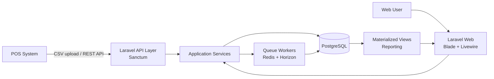
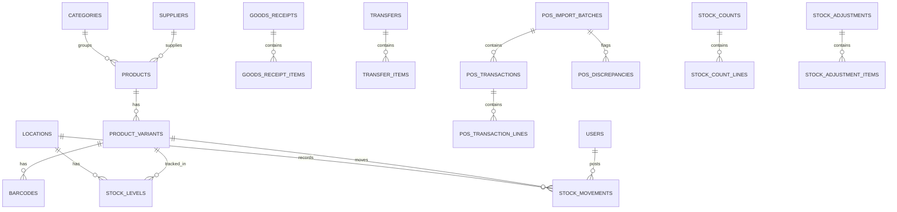

# Project Brief — Retail Inventory Management Platform

| Item | Detail |
|---|---|
| Klien | Confidential (via NDA) |
| Jenis engagement | Contract, 1–3 bulan (fase awal) |
| Lokasi | Remote / Worldwide |
| Tech stack | Laravel · Livewire · Bootstrap · PostgreSQL |
| Pengembang | Salman Alfarisi Rizwana |
| Versi dokumen | 0.2 — 5 November 2026 (UI: Bootstrap; requirement lengkap ada di `PRD-retail-inventory.md`) |

---

## 1. Ringkasan Proyek

Membangun platform manajemen inventaris retail berbasis web untuk **satu lokasi toko** pada fase awal, dengan arsitektur yang **siap multi-lokasi** sejak hari pertama. Sistem mencakup database inventaris terpusat, pelacakan SKU dan varian, pencatatan seluruh pergerakan stok, integrasi data penjualan dari POS, rekonsiliasi stok fisik vs sistem, serta dashboard manajemen.

Pengembangan diawasi oleh *independent systems architect* dari pihak klien, sehingga setiap milestone disertai dokumen teknis yang bisa direview.

---

## 2. Tujuan & Kriteria Sukses

**Tujuan**
1. Satu sumber kebenaran (*single source of truth*) untuk stok setiap SKU di setiap lokasi.
2. Setiap perubahan stok tercatat sebagai transaksi yang bisa ditelusuri (siapa, kapan, kenapa).
3. Selisih antara data POS, catatan sistem, dan hitungan fisik terdeteksi otomatis.
4. Manajemen bisa melihat kondisi stok dan pengecualian (exception) tanpa harus membuka spreadsheet.

**Kriteria sukses fase awal**
- Saldo stok bisa direkonstruksi ulang 100% dari riwayat transaksi (ledger).
- Import POS bersifat idempoten: file/transaksi yang sama tidak tercatat dua kali.
- Penyesuaian stok hasil stock count tidak bisa diposting tanpa approval.
- Demo end-to-end berjalan dengan sample data (tanpa koneksi ke toko live).
- Test coverage modul inti (ledger, import, rekonsiliasi) ≥ 80%.

---

## 3. Ruang Lingkup

### In scope (fase awal)
- Master data: produk, varian, SKU, barcode, kategori, supplier, satuan, lokasi.
- Transaksi inventaris: penerimaan barang, penjualan, retur, transfer, penyesuaian.
- Stock count (full count & cycle count) dan rekonsiliasi dengan approval.
- Integrasi POS via **CSV import** dan **REST API endpoint** (push dari POS).
- Dashboard manajemen dan laporan inventaris (export CSV/XLSX/PDF).
- Autentikasi, role-based access control, audit trail.
- Dokumentasi teknis dan serah terima source code.

### Out of scope (fase awal, bisa jadi fase lanjutan)
- Koneksi ke POS di toko live (butuh otorisasi terpisah dari klien).
- Modul purchasing lengkap (PO, approval pembelian, hutang supplier).
- Akuntansi / general ledger keuangan.
- Aplikasi mobile native (fase awal cukup web responsif + dukungan barcode scanner USB/Bluetooth).
- Forecasting / demand planning.

---

## 4. Pengguna & Peran

| Peran | Hak akses utama |
|---|---|
| **Super Admin** | Kelola user, peran, lokasi, konfigurasi sistem |
| **Store Manager** | Semua transaksi di lokasinya, approve stock adjustment & rekonsiliasi, lihat dashboard |
| **Inventory Staff** | Input penerimaan, transfer, retur, input hasil hitung stok (tanpa approval) |
| **POS Integrator** | Akun teknis untuk upload/push data penjualan via API |
| **Auditor / Viewer** | Read-only: laporan, riwayat transaksi, audit log |

Semua peran bersifat **location-scoped**: user hanya melihat dan mengubah data di lokasi yang di-assign kepadanya.

---

## 5. Tech Stack

| Layer | Teknologi | Catatan |
|---|---|---|
| Backend | **Laravel** (versi stabil terbaru), PHP 8.3+ | Modular monolith per domain |
| Frontend | **Blade + Livewire + Alpine.js + Bootstrap** | Interaktif tanpa SPA terpisah; komponen JS Bootstrap dikendalikan lewat Alpine atau `wire:ignore`; pagination Livewire tema `bootstrap` |
| Chart | ApexCharts / Chart.js | Untuk dashboard |
| Database | **PostgreSQL** 16+ | `NUMERIC` untuk qty/nilai, `JSONB` untuk payload POS, partial index, materialized view untuk laporan |
| Auth | Laravel Fortify (web) + Sanctum (API token) | 2FA opsional untuk admin/manager |
| RBAC | `spatie/laravel-permission` | Role + permission, scoped per lokasi |
| Audit | `spatie/laravel-activitylog` + ledger immutable | Perubahan master data & aksi user |
| Queue | Laravel Queue (Redis) + Horizon | Import POS & generate laporan berjalan di background |
| Import/Export | `spatie/simple-excel` atau Laravel Excel | CSV/XLSX streaming untuk file besar |
| PDF | `barryvdh/laravel-dompdf` atau Browsershot | Laporan cetak |
| Testing | Pest + Laravel Dusk (opsional untuk E2E) | |
| CI/CD | GitHub Actions | Lint (Pint), static analysis (Larastan), test |
| Hosting | Docker; target VPS / AWS / GCP sesuai pilihan klien | Repo & infrastruktur di akun milik klien |

**Catatan untuk klien:** iklan menyebut Python/JavaScript/PostgreSQL sebagai preferensi "or comparable technologies". Laravel + PostgreSQL dipilih karena ekosistemnya matang untuk aplikasi bisnis berbasis transaksi (ORM, queue, auth, validation, testing bawaan), dan PostgreSQL tetap jadi database utama sesuai preferensi klien.

---

## 6. Arsitektur Sistem



### Struktur modul (modular monolith)

```
app/
├── Domain/
│   ├── Catalog/          # Product, Variant, SKU, Barcode, Category, Supplier
│   ├── Inventory/        # StockLevel, StockMovement, Receipt, Transfer, Return, Adjustment
│   ├── Pos/              # Import batch, POS transaction, SKU mapping, discrepancy
│   ├── Reconciliation/   # StockCount, CountLine, Variance, Approval
│   ├── Reporting/        # Query objects, materialized view refresh, exports
│   └── Identity/         # User, Role, Location scope, Audit
├── Http/                 # Controllers, Livewire components, API resources
└── Support/              # Shared helpers, value objects (Quantity, Money)
```

Setiap domain punya **Action/Service class** sendiri (mis. `PostStockMovement`, `ImportPosBatch`, `ApproveStockCount`), sehingga logika bisnis tidak tercampur di controller dan mudah diuji.

---

## 7. Prinsip Desain Inventaris

1. **Ledger-based** — stok tidak pernah di-update langsung. Setiap perubahan = satu baris di `stock_movements`. Tabel `stock_levels` hanyalah saldo cache yang diperbarui dalam transaksi DB yang sama.
2. **Immutable** — movement yang sudah diposting tidak bisa diedit/dihapus. Koreksi dilakukan dengan movement pembalik (*reversal*).
3. **Location-aware** — semua tabel transaksi punya `location_id` sejak awal, walaupun fase awal hanya 1 toko.
4. **Concurrency-safe** — posting movement memakai `SELECT ... FOR UPDATE` pada baris `stock_levels` untuk mencegah race condition.
5. **Idempoten** — import POS memakai unique key (`source + location + external_id`) dan hash file, sehingga upload ulang aman.
6. **Approval sebelum posting** — hasil stock count dan adjustment berstatus *draft* sampai disetujui manager.
7. **Point-in-time** — saldo stok pada tanggal mana pun bisa dihitung dari ledger (untuk laporan historis & audit).

---

## 8. Modul & Fitur Detail

### 8.1 Catalog (Produk & SKU)
- CRUD produk dengan atribut varian (ukuran, warna, rasa, kemasan, dll.) → setiap kombinasi = 1 SKU.
- Multiple barcode per SKU (EAN-13, UPC, barcode internal).
- Kategori bertingkat, brand, supplier default, satuan dasar.
- Reorder point & minimum stock per lokasi.
- Import massal produk via CSV dengan validasi & preview sebelum disimpan.
- Status SKU: active, inactive, discontinued.

### 8.2 Inventory Transactions
| Transaksi | Efek ke stok | Dokumen |
|---|---|---|
| Goods Receipt (penerimaan) | + | `goods_receipts` + items |
| Sale (dari POS) | − | `pos_transactions` |
| Customer Return | + | `returns` |
| Supplier Return | − | `returns` |
| Transfer Out / In | − di asal / + di tujuan | `transfers` (status: draft → in_transit → received) |
| Adjustment (manual) | ± dengan reason code | `stock_adjustments` (butuh approval) |
| Count Adjustment | ± hasil rekonsiliasi | dari `stock_counts` |

Fitur pendukung:
- Kartu stok (stock card) per SKU: saldo awal, mutasi, saldo akhir.
- Reason code wajib untuk adjustment (rusak, hilang, expired, salah input, dll.).
- Lampiran bukti (foto/dokumen) pada penerimaan & adjustment.
- Input via barcode scanner (fokus field otomatis, scan → tambah qty).

### 8.3 POS Integration
**Metode yang didukung:**
1. **CSV/XLSX upload** — mapping kolom bisa dikonfigurasi per sumber POS (template disimpan).
2. **REST API** — endpoint `POST /api/v1/pos/transactions` dengan token Sanctum per integrasi, batch hingga N transaksi per request.
3. *(Fase lanjut)* Konektor langsung ke API vendor POS tertentu setelah vendor diketahui.

**Alur import:**
1. File/payload diterima → dibuat `pos_import_batch` (status `pending`), raw payload disimpan di `JSONB`.
2. Job di queue memvalidasi & memetakan setiap baris (`external_sku` → `product_variant_id` via barcode/SKU/mapping manual).
3. Baris valid diposting sebagai movement `sale` / `return`.
4. Baris bermasalah masuk `pos_discrepancies`.
5. Ringkasan batch: total baris, berhasil, duplikat, gagal.

**Jenis discrepancy yang dideteksi:**
- SKU/barcode tidak dikenal (unmapped).
- Transaksi duplikat.
- Penjualan menyebabkan stok negatif.
- Harga jual berbeda signifikan dari harga master.
- Transaksi di luar jam operasional / tanggal di masa depan.
- Gap nomor transaksi POS (indikasi data yang hilang).

### 8.4 Stock Count & Reconciliation
**Alur:**
1. Manager membuat *stock count session*: full count atau cycle count (per kategori / per rak / SKU pilihan).
2. Sistem mengambil **snapshot** saldo sistem (`expected_qty`) saat sesi dimulai.
3. Staff menginput hasil hitung (`counted_qty`), bisa dengan scanner, bisa oleh beberapa orang.
4. Jika ada movement setelah snapshot (mis. penjualan berjalan), sistem menyesuaikan `expected_qty` = snapshot + movement sesudah snapshot sampai waktu hitung.
5. Sistem menghitung variance (qty & nilai) dan menandai **exception** berdasarkan threshold yang bisa dikonfigurasi:
   - |variance qty| > X unit, atau
   - |variance %| > Y%, atau
   - |variance nilai| > Z.
6. Manager mereview exception: terima, minta hitung ulang (recount), atau beri catatan.
7. Setelah approve → sistem memposting `count_adjustment` movements secara atomik.
8. Laporan rekonsiliasi final tersimpan dan bisa diekspor.

**Status sesi:** `draft → counting → submitted → under_review → approved → posted` (atau `cancelled`).

### 8.5 Management Dashboard & Reports
**Dashboard (per lokasi & gabungan):**
- Total SKU aktif, total qty on hand, nilai persediaan.
- SKU di bawah reorder point / stok habis / stok negatif.
- Grafik pergerakan stok (masuk vs keluar) per periode.
- Shrinkage / variance rate dari stock count terakhir.
- Exception rekonsiliasi & discrepancy POS yang masih terbuka.
- Status import POS terakhir.
- Top SKU by movement, slow-moving & dead stock.

**Laporan:**
| Laporan | Filter |
|---|---|
| Stock on Hand (per tanggal) | lokasi, kategori, supplier, tanggal |
| Inventory Movement | periode, tipe movement, user, SKU |
| Product Inventory Summary | SKU/kategori |
| Stock Card per SKU | SKU, periode |
| Reconciliation Exception Report | sesi count, status |
| Adjustment History | periode, reason code, approver |
| POS Discrepancy Report | batch, jenis discrepancy |
| Aging / Slow-moving Stock | hari tanpa penjualan |

Semua laporan bisa diekspor ke CSV, XLSX, dan PDF. Laporan berat diproses di queue dan dikirim sebagai file unduhan.

### 8.6 Security, User & Audit
- Login dengan rate limiting, password policy, 2FA untuk Admin & Manager.
- RBAC + scope lokasi.
- Audit log untuk semua perubahan master data, approval, login, dan perubahan permission (siapa, kapan, IP, nilai sebelum/sesudah).
- API token per integrasi POS, bisa di-revoke, dengan scope terbatas.

---

## 9. Desain Database (PostgreSQL)

### 9.1 ERD ringkas



### 9.2 Tabel inti

| Kelompok | Tabel |
|---|---|
| Identity | `users`, `roles`, `permissions`, `model_has_roles`, `location_user`, `activity_log` |
| Master | `locations`, `categories`, `brands`, `suppliers`, `units`, `products`, `product_variants`, `variant_attributes`, `barcodes`, `variant_location_settings` (reorder point, min/max) |
| Inventory | `stock_levels`, `stock_movements`, `goods_receipts`, `goods_receipt_items`, `transfers`, `transfer_items`, `returns`, `return_items`, `stock_adjustments`, `stock_adjustment_items`, `reason_codes` |
| POS | `pos_sources`, `pos_column_mappings`, `pos_import_batches`, `pos_transactions`, `pos_transaction_lines`, `sku_mappings`, `pos_discrepancies` |
| Reconciliation | `stock_counts`, `stock_count_lines`, `count_assignments`, `reconciliation_settings` |
| Reporting | `mv_daily_stock_summary`, `mv_movement_by_type` (materialized views) |

### 9.3 Contoh definisi tabel kunci

**`stock_movements`** (ledger, append-only)
| Kolom | Tipe | Catatan |
|---|---|---|
| id | `bigint` identity | |
| location_id | `bigint` FK | |
| product_variant_id | `bigint` FK | |
| movement_type | `varchar` | `receipt`, `sale`, `customer_return`, `supplier_return`, `transfer_out`, `transfer_in`, `adjustment`, `count_adjustment`, `reversal` |
| quantity | `numeric(14,3)` | bertanda (+/−), `CHECK (quantity <> 0)` |
| unit_cost | `numeric(14,4)` | nullable |
| balance_after | `numeric(14,3)` | saldo setelah movement |
| reference_type / reference_id | polymorphic | dokumen sumber |
| reversed_movement_id | `bigint` FK nullable | untuk koreksi |
| occurred_at | `timestamptz` | waktu kejadian bisnis |
| posted_by | `bigint` FK users | |
| created_at | `timestamptz` | waktu pencatatan |

Index: `(location_id, product_variant_id, occurred_at)`, `(reference_type, reference_id)`, `(movement_type, occurred_at)`.
Proteksi: trigger PostgreSQL yang menolak `UPDATE`/`DELETE` pada tabel ini.

**`stock_levels`** (saldo cache)
| Kolom | Tipe |
|---|---|
| location_id + product_variant_id | composite unique |
| on_hand | `numeric(14,3)` |
| avg_cost | `numeric(14,4)` |
| last_movement_id | `bigint` |
| updated_at | `timestamptz` |

**`pos_transactions`**
- `UNIQUE (pos_source_id, location_id, external_id)` → idempotensi.
- `raw_payload JSONB` untuk jejak data asli.

**`stock_count_lines`**
- `expected_qty`, `counted_qty`, `variance_qty` (generated column = counted − expected), `variance_value`, `is_exception`, `recount_requested`, `note`.

### 9.4 Command verifikasi integritas
`php artisan inventory:verify` → membandingkan `stock_levels.on_hand` dengan `SUM(stock_movements.quantity)` per SKU per lokasi, melaporkan selisih. Dijadwalkan harian.

---

## 10. API Endpoints (v1)

| Method | Endpoint | Fungsi |
|---|---|---|
| POST | `/api/v1/auth/token` | Ambil token integrasi |
| GET | `/api/v1/products` | Daftar produk & varian |
| GET | `/api/v1/variants/{sku}` | Detail SKU + barcode |
| GET | `/api/v1/stock-levels` | Saldo stok (filter lokasi/SKU) |
| GET | `/api/v1/stock-movements` | Riwayat movement (paginated) |
| POST | `/api/v1/pos/transactions` | Push transaksi POS (batch) |
| POST | `/api/v1/pos/imports` | Upload file CSV/XLSX |
| GET | `/api/v1/pos/imports/{id}` | Status & ringkasan batch |
| GET | `/api/v1/reconciliations/{id}` | Hasil rekonsiliasi |

Dokumentasi API dibuat dengan OpenAPI (mis. Scribe / Scramble) dan versioning lewat prefix `/v1`.

---

## 11. Keamanan

- HTTPS wajib, HSTS, secure & httpOnly cookies, CSRF protection.
- Validasi input di Form Request; query via Eloquent/parameter binding (anti SQL injection).
- Policy Laravel di setiap aksi + scope lokasi di level query (global scope).
- Rate limit untuk login & API.
- Secrets di environment variables, tidak masuk repo.
- Backup PostgreSQL otomatis harian + retensi (mis. 14–30 hari), uji restore berkala.
- Least-privilege database user untuk aplikasi.
- Dependency scanning (`composer audit`, `npm audit`) di pipeline CI.
- Log aktivitas & error terpusat (Laravel log + opsional Sentry).

---

## 12. Skalabilitas & Kesiapan Multi-lokasi

- `location_id` di semua tabel transaksi; tambah toko = tambah data, bukan ubah skema.
- Transfer antar lokasi sudah tersedia di fase awal.
- Dashboard bisa difilter per lokasi atau gabungan.
- Laporan berat memakai materialized view + refresh terjadwal.
- Partisi tabel `stock_movements` per bulan/tahun saat volume besar (PostgreSQL declarative partitioning).
- Worker queue bisa diskalakan horizontal.
- Opsi read replica untuk reporting di fase lanjut.

---

## 13. Testing & Quality Assurance

| Jenis | Cakupan |
|---|---|
| Unit test | Perhitungan saldo, variance, threshold exception, mapping SKU |
| Feature test | Posting movement, import POS (termasuk duplikat & file rusak), approval flow, permission per role |
| Concurrency test | Posting simultan pada SKU yang sama tidak menghasilkan saldo salah |
| Data integrity test | `inventory:verify` lulus setelah skenario sample data penuh |
| E2E (opsional) | Alur penerimaan → penjualan POS → stock count → approval |
| Code quality | Laravel Pint, Larastan level ≥ 6, review oleh systems architect klien |

Sample data dibuat dengan seeder + factory: ±1 toko, 50 kategori, ±2.000 SKU, 90 hari transaksi POS sintetis, beserta skenario selisih yang disengaja untuk demo rekonsiliasi.

---

## 14. Deployment & Infrastruktur

- Environment: `local` (Docker / Laravel Sail), `staging`, `production`.
- Repository GitHub/GitLab di **akun milik klien**; developer diberi akses kolaborator.
- CI/CD GitHub Actions: test → build assets (Vite) → deploy ke staging; production deploy manual dengan approval.
- Infrastruktur minimal fase awal: 1 app server (Nginx + PHP-FPM + queue worker + scheduler), PostgreSQL managed atau di server terpisah, Redis.
- Semua akun cloud, domain, dan kredensial berada di bawah kontrol klien.

---

## 15. Milestone & Timeline (estimasi 12 minggu)

| Milestone | Minggu | Output | Deliverable klien |
|---|---|---|---|
| **M0 — Discovery & Architecture** | 1 | Dokumen arsitektur, ERD, rencana pengembangan, setup repo & CI | #1, #2 |
| **M1 — Foundation & Master Data** | 2–3 | Auth, RBAC, lokasi, katalog produk/varian/SKU/barcode, prototype database + seeder | #3 |
| **M2 — Inventory Ledger** | 4–5 | Stock movement, penerimaan, retur, transfer, adjustment, stock card; demo SKU tracking | #4 (bagian 1) |
| **M3 — POS Integration** | 6–7 | CSV import + API, SKU mapping, deteksi discrepancy, ringkasan batch | — |
| **M4 — Stock Count & Reconciliation** | 8–9 | Sesi hitung, snapshot, variance, exception, approval, posting adjustment; demo rekonsiliasi | #4 (bagian 2) |
| **M5 — Dashboard & Reports** | 10–11 | Dashboard manajemen, laporan, export CSV/XLSX/PDF | #5 |
| **M6 — Hardening & Handover** | 12 | Testing akhir, perbaikan, dokumentasi teknis & user guide, API docs, serah terima source code | #6 |

> Opsi **MVP 8 minggu**: M3 hanya CSV import, dashboard dengan KPI inti, laporan ekspor CSV saja. Fitur sisanya dipindah ke fase 2.

Setiap akhir milestone: demo ke klien & systems architect, review kode, lalu sign-off sebelum lanjut.

---

## 16. Estimasi Effort & Budget

| Milestone | Estimasi jam |
|---|---|
| M0 — Discovery & Architecture | 20–28 |
| M1 — Foundation & Master Data | 50–65 |
| M2 — Inventory Ledger | 60–75 |
| M3 — POS Integration | 50–65 |
| M4 — Stock Count & Reconciliation | 50–65 |
| M5 — Dashboard & Reports | 50–65 |
| M6 — Hardening & Handover | 30–40 |
| **Total** | **±310–400 jam** |

**Budget = total jam × rate per jam** (rate diisi saat proposal). Pembayaran per milestone setelah sign-off, misalnya:
- 15% — M0 selesai
- 20% — M1 + M2
- 20% — M3
- 20% — M4
- 25% — M5 + M6 (handover)

Biaya infrastruktur (server, database, domain) ditanggung klien dan di luar biaya pengembangan.

---

## 17. Pemetaan ke Deliverables Klien

| # | Deliverable yang diminta | Dipenuhi oleh |
|---|---|---|
| 1 | Proposed software development architecture | Dokumen arsitektur M0 (bagian 6, 7, 9) |
| 2 | Development plan & milestone schedule | Bagian 15 + rencana detail M0 |
| 3 | Functional inventory database prototype | M1 — skema PostgreSQL + seeder sample data |
| 4 | Demo SKU tracking & reconciliation | M2 + M4 |
| 5 | Preliminary management dashboard | M5 |
| 6 | Technical documentation & source-code handover | M6 |
| 7 | Development budget & implementation timeline | Bagian 15–16 |

---

## 18. Asumsi

- Fase awal: 1 lokasi, ≤ 10.000 SKU, ≤ 5.000 transaksi POS per hari.
- Data POS tersedia dalam format CSV/XLSX atau bisa di-push via API.
- Metode costing: **weighted average** (bisa diganti FIFO jika klien memerlukan).
- Satu mata uang; pajak tidak dihitung di sistem inventaris.
- Klien menyediakan akun hosting, repo, dan domain.
- Seluruh demo memakai sample data; integrasi toko live butuh otorisasi tertulis terpisah.

## 19. Risiko & Mitigasi

| Risiko | Dampak | Mitigasi |
|---|---|---|
| Format data POS belum diketahui | Integrasi molor | Column mapping yang bisa dikonfigurasi; minta contoh file di M0 |
| SKU di POS tidak konsisten dengan master | Banyak discrepancy | Tabel `sku_mappings` + layar mapping manual |
| Penjualan berjalan saat stock count | Variance palsu | Snapshot + penyesuaian movement setelah snapshot |
| Perubahan scope di tengah jalan | Timeline mundur | Change request tertulis, sign-off per milestone |
| Volume data tumbuh cepat | Laporan lambat | Materialized view, index, partisi tabel |

## 20. Pertanyaan Terbuka untuk Klien / Systems Architect

1. POS apa yang dipakai (vendor & versi)? Apakah punya API resmi?
2. Berapa jumlah SKU dan rata-rata transaksi harian saat ini?
3. Atribut varian apa saja yang digunakan (ukuran, warna, kemasan, dll.)?
4. Perlu konversi satuan (mis. karton → pcs)?
5. Metode costing yang diinginkan: weighted average atau FIFO?
6. Perlu pelacakan batch / tanggal kedaluwarsa (penting untuk convenience store)?
7. Seberapa sering stock count dilakukan, dan berapa threshold variance yang dianggap wajar?
8. Preferensi hosting (AWS, GCP, Azure, VPS lokal)?
9. Apakah ada data historis yang perlu dimigrasi?
10. Perangkat input apa yang dipakai staff (PC, tablet, barcode scanner)?

---

## Lampiran A — Definition of Done (per fitur)

- [ ] Kode lolos lint, static analysis, dan seluruh test.
- [ ] Ada feature test untuk alur utama & edge case.
- [ ] Permission & scope lokasi sudah diterapkan.
- [ ] Aksi penting tercatat di audit log.
- [ ] Migration bisa di-rollback.
- [ ] Dokumentasi (README modul / API docs) diperbarui.
- [ ] Sudah didemokan dan di-review di staging.
