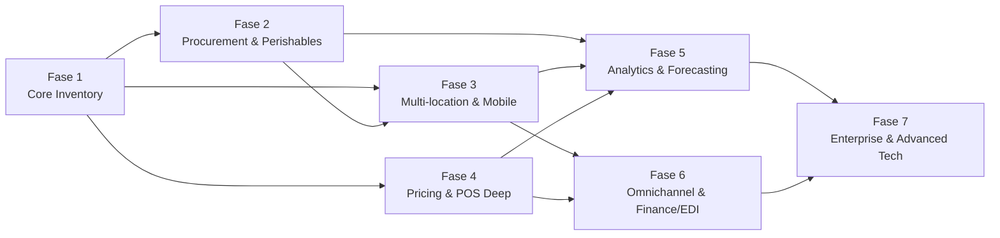
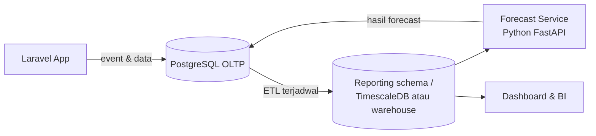

# Roadmap Full Phase — Retail Inventory Management Platform

| Item | Detail |
|---|---|
| Dokumen induk | `project-brief-retail-inventory.md` (Fase 1) |
| Tech stack inti | Laravel · Livewire · Bootstrap · PostgreSQL |
| Total fase | **7 fase** |
| Estimasi total | ±15–18 bulan (solo/tim kecil, berurutan) · ±9–12 bulan (tim 3–4 orang, sebagian paralel) |
| Versi | 0.1 — 5 November 2026 |

---

## 1. Gambaran Besar

Fase 1 (di brief awal) membangun **inti inventaris untuk satu toko**: master SKU, ledger stok, import POS, stock count & rekonsiliasi, dan dashboard dasar.

Untuk sistem yang utuh, platform retail modern biasanya juga punya: pengadaan & supplier, kontrol batch/kedaluwarsa (penting untuk convenience store), operasional multi-toko dan gudang, aplikasi scanning mobile, manajemen harga & promo, analitik KPI dan forecasting, analisis shrinkage, sinkronisasi omnichannel, integrasi akuntansi/EDI, hingga skala enterprise (multi-company, RFID, IoT, AI).

### Ringkasan fase

| Fase | Nama | Fokus utama | Durasi | Estimasi jam |
|---|---|---|---|---|
| **1** | Core Inventory (MVP) | Ledger stok, SKU, POS import, rekonsiliasi, dashboard dasar | 12 minggu | 310–400 |
| **2** | Procurement, Supplier & Perishables | PO, penerimaan vs PO, auto-reorder, batch & expiry, landed cost | 8–10 minggu | 280–360 |
| **3** | Multi-location, Warehouse & Mobile Ops | Rollout multi-toko, gudang/DC, bin location, aplikasi scanning offline | 10–12 minggu | 380–480 |
| **4** | Pricing, Promotion & Deep POS Integration | Price book, promo, label rak, konektor POS real-time | 6–8 minggu | 220–300 |
| **5** | Analytics, Forecasting & Loss Prevention | KPI retail, ABC/XYZ, demand forecast, saran replenishment, shrinkage analytics | 10–12 minggu | 380–500 |
| **6** | Omnichannel & Financial/EDI Integration | E-commerce/marketplace sync, BOPIS, akuntansi, EDI, public API | 10–12 minggu | 380–500 |
| **7** | Enterprise Scale & Advanced Tech | Multi-company/franchise, RFID, IoT cold chain, AI assistant, HA | 8–12 minggu (lanjut iteratif) | 300–450 |
| | **Total** | | **±64–78 minggu** | **±2.250–2.990 jam** |

### Dependensi antar fase

- **Fase 2 dan 4** bisa berjalan paralel setelah Fase 1 jika ada 2 developer.
- **Fase 5** butuh data historis minimal ±8–12 minggu dari toko live agar forecasting bermakna; kalau belum ada, mulai dari KPI & analitik dulu, forecasting menyusul.

---

## 2. Fase 1 — Core Inventory (MVP)

Sudah dijabarkan lengkap di `project-brief-retail-inventory.md`. Ringkasnya:
- Master produk, varian, SKU, barcode, kategori, supplier dasar.
- Ledger stok immutable (receipt, sale, return, transfer, adjustment).
- Import POS via CSV & REST API, deteksi discrepancy.
- Stock count, variance, exception, approval.
- Dashboard & laporan dasar, RBAC, audit trail.
- Arsitektur sudah `location_id`-aware untuk fase berikutnya.

---

## 3. Fase 2 — Procurement, Supplier & Perishables

**Tujuan:** menutup siklus *beli → terima → jual*, dan mengendalikan barang yang punya masa kedaluwarsa (makanan, minuman, obat bebas, kosmetik — dominan di convenience store).

### 3.1 Fitur

**Supplier management**
- Profil supplier lengkap: kontak, termin pembayaran, mata uang, lead time default, MOQ (minimum order qty), pack size.
- Katalog harga per supplier per SKU (multi-supplier per SKU, dengan supplier prioritas).
- Scorecard supplier: ketepatan waktu kirim, fill rate (qty dikirim vs dipesan), tingkat retur/cacat, selisih harga.

**Purchase order (PO)**
- Alur: draft → submitted → approved → sent → partially received → received → closed/cancelled.
- Approval bertingkat berdasarkan nilai PO.
- Kirim PO ke supplier via email (PDF) atau portal.
- PO dibuat dari saran reorder (lihat di bawah) atau manual.

**Penerimaan barang vs PO**
- Receiving berdasarkan PO: qty diterima, qty rusak, qty kurang/lebih.
- **Three-way match**: PO ↔ penerimaan ↔ invoice supplier; selisih masuk antrian review.
- Blind receiving (opsional): staff menghitung tanpa melihat qty PO, untuk akurasi.
- Retur ke supplier (RTV) terhubung ke penerimaan asal.

**Auto-reorder (berbasis aturan)**
- Reorder point, min/max, safety stock per SKU per lokasi.
- Perhitungan saran order: `(max − on_hand − on_order)` dibulatkan ke pack size & MOQ.
- Daftar saran reorder harian → bisa langsung dikonversi jadi PO.
- (Forecast-based reorder datang di Fase 5.)

**Batch / lot & expiry**
- Nomor batch, tanggal produksi, tanggal kedaluwarsa dicatat saat penerimaan (bisa scan GS1 barcode yang memuat expiry).
- Stok per batch; penjualan & transfer mengurangi batch dengan aturan **FEFO** (first-expired, first-out).
- Alert kedaluwarsa: 30/60/90 hari (bisa diatur per kategori).
- Dashboard "at-risk value": nilai stok yang akan kedaluwarsa dalam N hari.
- Alur write-off barang kedaluwarsa (dengan approval & reason code).
- Pelacakan recall: cari batch tertentu ada di lokasi mana dan sudah terjual berapa.

**Costing lanjutan**
- Pilihan metode: weighted average atau FIFO per perusahaan.
- **Landed cost**: alokasikan ongkos kirim, bea, asuransi ke unit barang (berdasarkan nilai, qty, berat, atau volume).
- Konversi satuan (karton → pak → pcs) dengan faktor konversi per SKU.

### 3.2 Tabel database tambahan
`supplier_products`, `supplier_price_lists`, `purchase_orders`, `purchase_order_items`, `po_approvals`, `supplier_invoices`, `supplier_invoice_items`, `three_way_match_exceptions`, `reorder_rules`, `reorder_suggestions`, `batches`, `batch_stock_levels`, `expiry_alerts`, `landed_cost_vouchers`, `landed_cost_allocations`, `unit_conversions`, `cost_layers` (untuk FIFO).

### 3.3 Deliverable & kriteria sukses
- Siklus PO end-to-end berjalan dengan sample data.
- Selisih three-way match terdeteksi otomatis.
- Laporan stok per batch & laporan near-expiry akurat.
- Nilai persediaan (FIFO/average + landed cost) cocok dengan perhitungan manual uji.

---

## 4. Fase 3 — Multi-location, Warehouse & Mobile Operations

**Tujuan:** rollout ke banyak toko dan gudang pusat, dengan operasional lapangan lewat perangkat mobile.

### 4.1 Fitur

**Multi-location rollout**
- Onboarding toko baru (wizard: data lokasi, user, setting, import stok awal).
- Dashboard terpusat + perbandingan performa antar toko.
- Setting per lokasi: reorder point, harga lokal (disiapkan untuk Fase 4), jam operasional, threshold variance.
- Hierarki lokasi: perusahaan → region → toko / gudang.

**Gudang / Distribution Center (hub-and-spoke)**
- Tipe lokasi: store, warehouse/DC, transit, virtual (mis. "barang rusak", "karantina").
- **Bin / rak location** di gudang dan back-store (zona → rak → level → bin).
- Putaway setelah penerimaan, picking untuk transfer ke toko.
- **Store replenishment dari DC**: toko mengajukan request, DC approve & kirim, atau DC push otomatis berdasarkan min/max toko.
- Transfer dengan status in-transit, bukti kirim/terima, selisih kirim vs terima.
- Aturan alokasi barang terbatas antar toko (berdasarkan penjualan/prioritas).

**Aplikasi mobile scanning**
- **PWA** (Progressive Web App) dulu, karena satu codebase Laravel dan bisa dipasang di Android scanner (Zebra, Honeywell, dll.) atau HP biasa (scan via kamera).
- Mode **offline**: transaksi diantrikan di perangkat (IndexedDB) dan disinkronkan saat koneksi kembali, dengan ID idempoten agar aman di-retry.
- Workflow terpandu: receiving, putaway, picking, transfer, cycle count, price check, cek stok.
- Validasi di perangkat: satuan, qty wajar, barcode salah.
- Opsi lanjutan: aplikasi native (Flutter/React Native) bila butuh integrasi hardware lebih dalam.

**Cycle count terjadwal**
- Program cycle count otomatis berbasis **ABC**: SKU kelas A dihitung lebih sering, C lebih jarang.
- Jadwal hitung harian kecil (micro-count) per zona/kategori.
- Recount otomatis bila variance melebihi threshold.
- KPI akurasi stok (inventory record accuracy) per toko.

**Label & barcode**
- Generate dan cetak label barcode SKU, label bin, label palet/karton (ZPL untuk printer Zebra atau PDF).

### 4.2 Tabel database tambahan
`location_groups`, `warehouse_zones`, `bins`, `bin_stock_levels`, `putaway_tasks`, `pick_lists`, `pick_list_items`, `replenishment_requests`, `allocation_rules`, `cycle_count_programs`, `cycle_count_schedules`, `device_registrations`, `offline_sync_logs`, `label_templates`.

### 4.3 Tambahan teknologi
- Service worker + IndexedDB (offline PWA).
- Laravel Reverb / WebSocket untuk update real-time antar perangkat.
- Library barcode di browser (mis. ZXing) untuk scan via kamera.

### 4.4 Deliverable & kriteria sukses
- 3+ lokasi demo (1 DC + 2 toko) dengan alur replenishment lengkap.
- Cycle count via PWA berjalan saat offline lalu tersinkron tanpa duplikasi.
- Akurasi stok per toko terukur dan tampil di dashboard.

---

## 5. Fase 4 — Pricing, Promotion & Deep POS Integration

**Tujuan:** sistem inventaris menjadi pusat data harga & promo, dan integrasi POS naik dari import file ke sinkronisasi real-time dua arah.

### 5.1 Fitur

**Price book terpusat**
- Harga dasar, harga per lokasi/region, harga per grup pelanggan (opsional).
- Penjadwalan perubahan harga (berlaku mulai tanggal X).
- Riwayat harga & audit siapa yang mengubah.
- Monitoring margin: peringatan bila harga jual di bawah HPP + margin minimum.

**Promosi & markdown**
- Jenis promo: diskon %, potongan nominal, beli X gratis Y, bundling, harga spesial periode tertentu.
- Markdown untuk barang near-expiry atau slow-moving (terhubung ke Fase 2 dan 5).
- Evaluasi promo: penjualan saat promo vs baseline.

**Label rak**
- Cetak label harga rak saat harga berubah (batch print per lokasi).
- Opsional: integrasi ESL (electronic shelf label) di Fase 7.

**Deep POS integration**
- Konektor khusus per vendor POS (setelah vendor diketahui) via API resmi.
- **Dua arah**: harga, produk, promo didorong ke POS; penjualan, retur, void ditarik dari POS.
- Webhook masuk dari POS untuk transaksi near real-time.
- Monitoring kesehatan integrasi: jeda sinkron, error rate, retry queue, alert.
- Rekonsiliasi harian otomatis: total penjualan POS vs total movement di sistem.

**Pencatatan event POS berisiko**
- Simpan event void, refund, no-sale, price override, diskon manual per kasir untuk dianalisis di Fase 5 (loss prevention).

### 5.2 Tabel database tambahan
`price_lists`, `price_list_items`, `scheduled_price_changes`, `price_history`, `promotions`, `promotion_rules`, `promotion_items`, `markdowns`, `shelf_label_jobs`, `pos_connectors`, `pos_sync_jobs`, `pos_webhook_events`, `pos_cashier_events`.

### 5.3 Deliverable & kriteria sukses
- Perubahan harga terjadwal tersinkron ke POS (atau POS simulator) tepat waktu.
- Rekonsiliasi harian POS vs sistem menghasilkan laporan selisih otomatis.
- Promo tercatat dan bisa dievaluasi dampaknya.

---

## 6. Fase 5 — Analytics, Forecasting & Loss Prevention

**Tujuan:** dari "mencatat" menjadi "membantu memutuskan": berapa yang harus dibeli, barang mana yang bermasalah, dan di mana stok hilang.

### 6.1 Fitur

**KPI retail standar** (per SKU, kategori, toko, periode)
| KPI | Rumus ringkas | Kegunaan |
|---|---|---|
| Inventory turnover | HPP ÷ rata-rata nilai persediaan | Seberapa cepat stok berputar |
| Days Sales of Inventory (DSI) | (rata-rata persediaan ÷ HPP) × hari | Berapa hari uang tertahan di stok |
| Days of supply | stok saat ini ÷ rata-rata penjualan harian | Kapan stok habis; dibandingkan dengan lead time |
| Sell-through rate | unit terjual ÷ unit diterima | Efektivitas pembelian |
| GMROI | gross margin ÷ rata-rata biaya persediaan | Profit per rupiah stok |
| Stock-to-sales ratio | nilai stok ÷ nilai penjualan | Keseimbangan stok vs penjualan |
| Stockout rate / frequency | SKU kosong ÷ SKU aktif | Ketersediaan barang |
| Inventory record accuracy | SKU akurat saat count ÷ SKU dihitung | Kualitas data |
| Shrinkage rate | nilai susut ÷ nilai penjualan | Kehilangan stok |
| Supplier fill rate & on-time | dari Fase 2 | Kinerja supplier |

**Analisis assortment**
- **ABC** (kontribusi nilai/penjualan) dan **XYZ** (stabilitas permintaan).
- Slow-moving, dead stock, aging stock report.
- Rekomendasi: kurangi pembelian, markdown, atau discontinue.

**Demand forecasting**
- Forecast per SKU per lokasi (harian/mingguan).
- Mempertimbangkan tren, musiman (mis. Ramadan, Natal, akhir tahun, gajian), hari dalam minggu, promo terjadwal.
- Pembersihan data: periode stockout tidak dihitung sebagai "permintaan nol".
- Cold-start SKU baru: pakai pola SKU serupa di kategori yang sama.
- Ukur akurasi forecast (MAPE / WAPE) dan tampilkan ke user.
- Mulai dari model statistik (moving average, exponential smoothing / ETS), lalu naik ke model ML (gradient boosting seperti LightGBM/XGBoost) bila data cukup.

**Forecast-driven replenishment**
- Saran order = forecast selama (lead time + periode review) + safety stock − stok tersedia − on order, dibulatkan ke MOQ/pack size.
- Planner hanya mereview exception (SKU dengan perubahan besar), sisanya bisa auto-approve.

**Loss prevention / shrinkage analytics**
- Susut dipecah per sumber: hasil count, write-off kedaluwarsa, rusak, selisih penerimaan supplier, selisih transfer.
- Analisis pola: SKU/kategori berisiko tinggi, toko, shift, kasir, supplier.
- Deteksi anomali event kasir (void/refund/override yang tidak wajar dibanding rata-rata).
- Alert otomatis + daftar kasus untuk ditindaklanjuti manajer.

**Reporting & BI**
- Dashboard eksekutif lintas toko.
- Report builder sederhana (pilih dimensi & metrik) + jadwal kirim laporan via email.
- Ekspor/konektor ke tool BI (Metabase, Power BI, Looker Studio) melalui read-only replica atau API.

### 6.2 Arsitektur tambahan

- **Forecast service** terpisah dalam Python (FastAPI + pandas + statsforecast/LightGBM), dipanggil via queue/API dari Laravel. Laravel tetap jadi sistem utama.
- Skema reporting terpisah (atau ekstensi TimescaleDB) agar query analitik berat tidak membebani transaksi.

### 6.3 Tabel database tambahan
`kpi_snapshots_daily`, `abc_xyz_classifications`, `demand_forecasts`, `forecast_accuracy_logs`, `replenishment_plans`, `shrink_events`, `anomaly_alerts`, `loss_prevention_cases`, `scheduled_reports`.

### 6.4 Deliverable & kriteria sukses
- Dashboard KPI lengkap dengan drill-down per toko/kategori/SKU.
- Forecast berjalan harian untuk seluruh SKU aktif, akurasi terukur.
- Saran replenishment berbasis forecast bisa dikonversi menjadi PO/transfer.
- Laporan shrinkage per sumber dan alert anomali aktif.

---

## 7. Fase 6 — Omnichannel & Financial/EDI Integration

**Tujuan:** satu stok untuk semua kanal penjualan, dan data inventaris mengalir otomatis ke keuangan & mitra dagang.

### 7.1 Fitur

**Omnichannel inventory**
- Sinkronisasi stok & harga ke e-commerce/marketplace (mis. Shopify, WooCommerce, atau marketplace lokal sesuai negara klien).
- **Available-to-promise (ATP)**: stok tersedia = on hand − reserved − safety buffer per kanal, untuk mencegah overselling.
- Reservasi stok untuk pesanan online.
- **BOPIS / click & collect**: pesanan online diambil di toko; alur picking & konfirmasi di PWA.
- **Ship-from-store**: pesanan online dipenuhi dari stok toko terdekat.
- Order routing sederhana: pilih lokasi pemenuh berdasarkan stok & jarak.
- Retur lintas kanal (beli online, retur di toko).

**Integrasi akuntansi**
- Jurnal otomatis: persediaan masuk, HPP saat terjual, penyesuaian/susut, landed cost, write-off.
- Ekspor/konektor ke software akuntansi (mis. Xero, QuickBooks, atau software lokal klien).
- Laporan valuasi persediaan untuk tutup buku bulanan + rekonsiliasi saldo persediaan vs GL.
- Penguncian periode (period close): transaksi di periode tertutup tidak bisa diposting.

**EDI dengan supplier besar** (jika relevan bagi klien)
- Dokumen standar: PO (850), PO acknowledgment (855), advance ship notice / ASN (856), inventory advice (846), invoice (810).
- Lewat penyedia EDI/VAN atau API; ASN otomatis membuat draft penerimaan barang.

**Portal supplier (opsional)**
- Supplier melihat PO, konfirmasi, input ASN, upload invoice.

**Platform terbuka**
- Public REST API terdokumentasi (OpenAPI), OAuth2 (Laravel Passport) untuk aplikasi pihak ketiga.
- Webhook keluar: stok berubah, PO dibuat, stok rendah, dll.
- SSO perusahaan (SAML / OIDC, mis. Google Workspace / Microsoft Entra).

### 7.2 Tabel database tambahan
`sales_channels`, `channel_listings`, `channel_sync_logs`, `stock_reservations`, `online_orders`, `fulfillment_tasks`, `gl_accounts_mapping`, `journal_batches`, `journal_entries`, `accounting_periods`, `edi_partners`, `edi_documents`, `supplier_portal_users`, `api_clients`, `webhook_subscriptions`, `webhook_deliveries`.

### 7.3 Deliverable & kriteria sukses
- Stok satu SKU berubah di toko → tersinkron ke kanal online dalam hitungan menit.
- Tidak ada overselling pada skenario uji pesanan simultan.
- Jurnal persediaan & HPP bulanan cocok dengan laporan valuasi.
- ASN supplier otomatis menjadi draft penerimaan.

---

## 8. Fase 7 — Enterprise Scale & Advanced Technology

**Tujuan:** siap untuk jaringan ritel besar, franchise, dan teknologi otomasi lanjutan. Fase ini bersifat modular — klien memilih item sesuai kebutuhan.

### 8.1 Fitur

**Multi-company / franchise**
- Multi-tenant: beberapa perusahaan/franchisee dalam satu platform, data terisolasi.
- Konsolidasi laporan di level franchisor.
- Katalog pusat yang bisa diturunkan ke franchisee, dengan izin override lokal.

**RFID**
- Integrasi pembaca RFID handheld & fixed untuk stock count cepat dan penerimaan karton.
- Encoding tag EPC saat penerimaan; rekonsiliasi berbasis RFID.
- Cocok untuk kategori bernilai tinggi atau fashion.

**IoT & cold chain**
- Sensor suhu chiller/freezer (MQTT) dengan alert bila keluar rentang aman.
- Barang di chiller bermasalah otomatis ditandai untuk inspeksi/karantina.
- Opsional: sensor rak (weight/shelf sensor), people counter untuk korelasi traffic vs penjualan.

**AI features**
- Asisten tanya-jawab bahasa natural atas data inventaris ("SKU mana yang paling sering selisih di toko B bulan ini?").
- Ringkasan otomatis exception harian untuk manajer.
- Rekomendasi markdown & transfer antar toko untuk barang yang hampir kedaluwarsa atau slow-moving.

**Electronic Shelf Label (ESL)**
- Harga di rak otomatis berubah mengikuti price book (Fase 4).

**Skalabilitas & keandalan**
- PostgreSQL high availability (replika + failover), read replica untuk reporting.
- Partisi tabel ledger per periode; arsip data lama.
- Horizontal scaling app & queue (container orchestration).
- Observability: metrics, tracing, log terpusat, uptime monitoring, SLO.
- Disaster recovery plan + uji restore berkala.

**Compliance & governance**
- Kebijakan retensi data, enkripsi at-rest, rotasi kunci.
- Penetration test & audit keamanan independen.
- Kontrol akses berbasis atribut (ABAC) untuk organisasi besar.

### 8.2 Deliverable & kriteria sukses
- Uji beban: target ratusan toko dan jutaan movement per bulan tanpa degradasi signifikan.
- Pilot RFID/IoT di 1 lokasi dengan laporan dampak akurasi/kerugian.
- Tenant franchise terisolasi penuh (uji kebocoran data).

---

## 9. Hal Lintas Fase (berlaku di setiap fase)

| Area | Praktik |
|---|---|
| Arsitektur | Modular monolith Laravel; layanan Python hanya untuk forecasting/ML |
| Data | Ledger immutable tetap jadi sumber kebenaran; fitur baru menambah tipe movement, bukan mengubah stok langsung |
| Testing | Unit + feature test per modul; uji regresi saldo stok setiap rilis |
| Keamanan | Review RBAC tiap modul baru; audit log untuk setiap aksi sensitif |
| Dokumentasi | Update dokumen arsitektur, ERD, API docs, user guide per fase |
| Rilis | Feature flag untuk modul baru; rollout bertahap per toko |
| Governance | Demo & sign-off dengan systems architect klien di akhir tiap milestone |

---

## 10. Rekomendasi Prioritas

Dengan konteks iklan (convenience store, rencana multi-lokasi, partner jangka panjang):

| Prioritas | Fase | Alasan |
|---|---|---|
| **Wajib** | 1 → 2 → 3 | Inti + pengadaan + expiry + multi-toko adalah kebutuhan dasar c-store berjaringan |
| **Sangat disarankan** | 4, 5 (KPI & shrinkage dulu, forecasting menyusul) | Harga terpusat & analitik susut langsung berdampak ke margin |
| **Sesuai strategi bisnis** | 6 | Hanya jika klien berjualan online atau butuh integrasi akuntansi/EDI |
| **Opsional / jangka panjang** | 7 | Saat jumlah toko besar atau mulai franchise |

**Skenario jalur cepat (±6–7 bulan):** Fase 1 → Fase 2 (tanpa landed cost & three-way match) → Fase 3 (PWA + multi-toko, tanpa bin location) → Fase 5 (KPI + shrinkage saja).

---

## 11. Pertanyaan untuk Menentukan Ruang Lingkup Fase Lanjutan

1. Berapa target jumlah toko dalam 1–2 tahun? Ada gudang pusat/DC?
2. Kategori produk apa yang dominan? Seberapa banyak yang punya tanggal kedaluwarsa?
3. Apakah ada rencana jualan online / marketplace?
4. Software akuntansi apa yang dipakai?
5. Apakah ada supplier besar yang mewajibkan EDI?
6. Ada rencana model franchise?
7. Perangkat apa yang dipakai staff di toko (HP, scanner Android, PC)?
8. Berapa lama data historis penjualan yang tersedia (untuk forecasting)?

---

## Referensi Riset

- Claimlane — Inventory Management Software for Retail Stores (2026): https://www.claimlane.com/resources/blog/inventory-management-software-for-retail-store
- AirPinpoint — Features of Stock Management System: https://airpinpoint.com/asset-tracking/features-of-stock-management-system
- BUSY — Batch and Expiry Inventory Management: https://busy.in/accounting-software/batch-expiry-inventory/
- BigSeller Help — Batch & Expiry Management: https://help.bigseller.pro/en_US/detailPage/4/1/8811/content
- Shopify — Demand Forecasting Software: https://www.shopify.com/blog/demand-forecasting-software
- Retano — Retail Demand Forecasting for Automated Replenishment: https://retano.ai/retail-demand-forecasting-software-for-automated-replenishment/
- Racklify — Technology to Prevent Shrinkage: https://racklify.com/encyclopedia/technology-to-prevent-shrinkage-cameras-rfid-wms-and-analytics/
- Sensormatic — Shrink Analyzer: https://www.sensormatic.com/en_ca/loss-prevention-liability/shrink-visibility/shrink-analyzer
- Cleverence — Mobile Scanner Cycle Count: https://www.cleverence.com/articles/business-blogs/mobile-scanner-cycle-count-4827/
- Manhattan Associates — Store Inventory Cycle Counting: https://www.manh.com/solutions/omnichannel-software-solutions/store-inventory-fulfillment/achieve-always-accurate-store-inventory
- VTEX — Omnichannel OMS (BOPIS, ship-from-store): https://vtex.com/gb-en/instore
- InventoryHero — Inventory KPIs (turnover, DSI, GMROI, days of supply): https://www.inventoryhero.ai/blog/inventory-kpis
- Qoblex — Essential Retail KPIs: https://qoblex.com/blog/essential-retail-kpis-complete-guide-to-measuring-store-performance-in-2025/
- ClearSpider — EDI Inventory Management: https://clearspider.net/blog/edi-inventory-management/
- Hyperbots — Landed Cost Software: https://www.hyperbots.com/glossary/landed-cost-software
